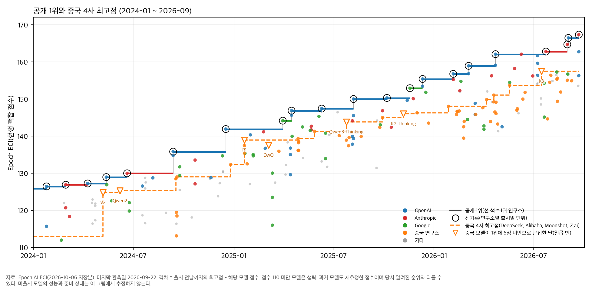
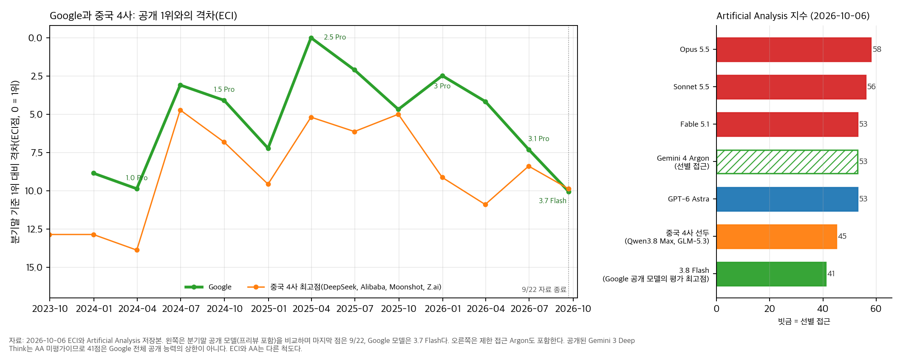

2025년 1월 27일, DeepSeek R1이 나오면서 AI 개발에 막대한 투자가 필요한지 의문이 번졌다. Nvidia 시가총액은 하루 새 약 5,900억 달러 [줄었다](https://seekingalpha.com/news/4399000-nvidia-broadcom-lead-tech-stocks-lower-amid-deepseek-ai-impact). 그날 OpenAI의 서랍에는 o3가 있었다. 한 달여 전 코딩 시험인 SWE-bench Verified에서 71.7%를 기록했다고 [발표했지만](https://tech.yahoo.com/computing/articles/openai-teases-breakthrough-next-generation-232702883.html), 일반 이용자는 아직 쓸 수 없던 모델이다.

R1의 성과는 컸다. Epoch AI의 능력 지수(ECI)로 보면 당시 공개 1위 o1과의 차이가 2.9점이었다. 다만 두 모델 모두 이용자가 쓸 수 있는 제품이었다. 연구소에 더 강한 미출시 모델이 있다면 공개 순위에서 보이는 격차보다 실제 능력 차이가 클 수 있다. R1이 공개 1위에 가까워졌다는 이유만으로 “최전선에서 첨단 칩의 우위가 사라졌다”고 결론 내리기는 이르다.

Anthropic은 2026년 4월 7일 [Mythos Preview](https://www.anthropic.com/glasswing)를 사이버 방어 파트너에게만 열고, 9일 뒤 [Opus 4.7](https://www.anthropic.com/news/claude-opus-4-7)을 일반 공개했다. 회사는 Opus 4.7의 전반적인 능력이 Mythos보다 낮다며, 이 모델부터 안전장치를 시험하겠다고 밝혔다. 성능이 높은 모델을 갖고 있어도 일반 이용자에게 내놓기까지는 준비가 더 필요할 수 있다. 칩 통제의 성패를 따지려면 순위표에 빠진 이런 사정도 살펴야 한다.

## 중국 모델이 근접한 뒤에는 무슨 일이 있었나

2023년 3월부터 2026년 9월 22일까지 ECI 신기록 22건 가운데 중국 연구소 몫은 없었다. 중국 4사인 DeepSeek, Alibaba, Moonshot, Z.ai의 최고점은 마지막 관측일에 공개 1위보다 약 10점 낮았다. 최근 공개 1위의 점수가 오른 속도로 환산하면 여덟 달 안팎의 차이다. 점수 차이를 시간으로 풀어 쓴 값일 뿐, 중국이 앞으로 따라잡는 데 걸릴 기간을 예측한 수치는 아니다.

그림 1. 공개된 모델의 ECI 최고점과 중국 4사 최고점. 삼각형은 중국 모델이 출시 직전의 공개 1위와 5점 미만의 차이로 근접한 일곱 번을 표시한다.

> ECI는 과거 모델의 점수도 다시 추정한다. 그림에는 2026년 10월 6일 내려받은 값을 썼으므로 당시 알려졌던 순위와 다를 수 있다. 시간 환산에는 최근 연간 최고점 상승폭인 약 13~17점을 썼다. 그림에는 공개 모델의 점수만 표시했다.

2024년 이후 중국 모델이 공개 1위에 5점 미만으로 붙은 사례는 일곱 번이었다. 그중 다섯 번은 14일 안에 미국 연구소에서 다음 신기록이 나왔다. 당시 미국 연구소가 어떤 미출시 모델을 갖고 있었는지 문서로 짚을 수 있는 경우는 R1, QwQ, K3의 세 번이다. 나머지 네 번은 후속 모델이 빨리 나왔다는 것만 확인된다. 중국 모델이 나온 그날 미국에서 얼마나 성능이 좋은 모델을 완성해 뒀는지는 알 수 없다.

| 중국 모델과 출시일 | 다음 미국 신기록까지[^dates] | 당시 미출시 모델의 근거 |
|---|---|---|
| DeepSeek V2 (2024-05-07) | 6일 (GPT-4o) | 비교 가능한 문서 미확인 |
| Qwen2 (2024-06-07) | 13일 (Claude 3.5 Sonnet) | 비교 가능한 문서 미확인 |
| R1 (2025-01-20) | 70일 (Gemini 2.5 Pro) | 앞서 발표한 o3의 시험 성적 |
| QwQ (2025-03-05) | 26일 (Gemini 2.5 Pro) | 앞서 발표한 o3의 시험 성적 |
| Qwen3 Thinking (2025-07-25) | 13일 (GPT-5) | 종합 성능을 비교할 문서 미확인[^imo] |
| Kimi K2 Thinking (2025-11-06) | 12일 (Gemini 3 Pro) | 비교 가능한 문서 미확인 |
| Kimi K3 (2026-07-16) | 8일 (Claude Opus 5) | 당시 내부 모델을 기록한 사후 보고서 |

같은 기간 중국 4사가 5점 넘게 뒤진 채 모델을 낸 경우도 셌다. 43회 중 16회, 약 37%에서 14일 안에 미국 신기록이 뒤따랐다. 1위에 근접했을 때의 71%보다 낮다. 다만 일곱 번은 작은 표본이고, 중국 모델이 1위에 붙은 시점이 마침 미국의 다음 출시 직전이었을 수도 있다. 순서가 이랬다는 사실만으로 미국이 중국 발표에 맞춰 출시를 앞당겼다고 단정하기는 어렵다.

문서가 있는 세 사례도 알려주는 내용은 서로 다르다. R1은 훗날 4월에 출시된 o3보다 ECI가 7.9점 낮았다. 앞의 속도로 환산하면 약 반년 차이다. 12월에 발표한 o3의 코딩 성적은 높았지만, 그것만으로 1월의 종합 능력이 4월 출시판과 같았다고 볼 근거는 부족하다.

Anthropic과 OpenAI는 나중에 낸 문서에서 K3 공개 무렵 이미 강한 미출시 모델이 있었다고 밝혔다. Anthropic의 8월 [위험 보고서](https://www-cdn.anthropic.com/f61d49fa5596956a5dec75fea0e973bf6a6a8378/Redacted%20Risk%20Report%20August%202026%20.pdf)는 7월 15일 기준으로 Opus 5와 별도 내부 모델을 다뤘다. [Opus 5](https://www.anthropic.com/news/claude-opus-5)는 K3 출시 여드레 뒤 공개 1위에 올랐다. OpenAI도 7월 보안 사고 [공지](https://openai.com/index/hugging-face-model-evaluation-security-incident/)에서 공개 모델보다 강한 연구 모델의 존재를 밝혔다.[^internal] 다만 회사가 밝힌 상대평가만으로 미출시 모델의 정확한 ECI 점수를 정할 수는 없다.

## 출시를 기다릴 여력

강한 모델을 일반에 열기 전에도 연구소는 기존 제품으로 돈을 벌 수 있다. OpenAI는 o3를 발표하고 일반 서비스로 내놓기까지 117일 동안 여러 제품을 출시했다. 그중 [Deep Research](https://openai.com/index/introducing-deep-research/)는 o3의 변형을 썼다. 모델 자체의 일반 공개를 늦추더라도 특정 상품에 넣어 팔 수 있다는 얘기다.

| 사례 | 공개 자료에서 확인되는 기간 | 그동안 제공한 상품 |
|---|---|---|
| OpenAI o3 | 2024-12-20 발표 → 2025-04-16 일반 서비스: 117일 | o3-mini, GPT-4.5, GPT-4.1, o3 변형을 쓴 Deep Research |
| Anthropic Mythos Preview | 2026-04-07 제한 공개 → 06-09 후속작 Fable 5 일반 공개: 63일 | Opus 4.7과 4.8 |

두 기간 모두 모델의 존재를 알린 날부터 센 값이다. 완성된 날은 확인되지 않았고, Mythos의 63일은 같은 모델이 아닌 후속작 Fable 5가 나온 날까지다. 일반 공개 예정 제품이 아닌 내부 연구 모델 IM1에는 이런 기간을 매길 수 없다. 당시 OpenAI는 GPT-5.6 Sol을 서비스했다.

Moonshot은 K3를 발표 당일 서비스했지만, 발표 전에 얼마나 보류했는지는 알려져 있지 않다. 중국 4사 모두 이 기간을 확인할 자료가 부족하다. 기록이 없다고 내부 대기 시간을 0일로 세거나, 그동안 팔 상품이 없었다고 해석하면 곤란하다.

내가 생각하는 한 가지 설명은 칩과 수입의 차이다. 연산 자원이 넉넉하면 연구 모델과 판매용 모델을 함께 개발하기 쉽다. 다른 사업에서 돈을 벌거나 현금을 충분히 확보했다면 새 모델을 팔 때까지 기다릴 수도 있다. Moonshot이 K3를 늦췄다면 이전 최고 모델 K2.6은 공개 1위에 약 11점 뒤진 상태였을 것이다. 반면 Google은 검색 수입으로 모델 개발과 서비스 비용을 감당할 수 있다. 기다리는 동안 수입을 얼마나 유지할 수 있느냐에 따라 출시를 서두를 이유도 달라질 수 있다.

중국 기업들은 칩이 부족하다고 말한다. Alibaba의 Eddie Wu는 5월 실적 발표에서 서버에 쓰지 않는 카드가 한 장도 없다고 [말했다](https://www.thepaper.cn/newsDetail_forward_33174268). DeepSeek의 Liang Wenfeng은 2024년 [인터뷰](https://thechinaacademy.org/interview-with-deepseek-founder-were-done-following-its-time-to-lead/)에서 자금보다 고급 칩 수출 제한을 걸림돌로 꼽았다. 칩이 부족하면 공개를 서두를 압박이 생길 수 있지만, 안전 검증이나 서비스 용량 때문에 출시가 늦어질 수도 있다.

올해 5월 투자자 회의의 [유출 녹취](https://chinaresearchcollective.substack.com/p/liang-wenfeng-investor-meeting-may)에는 DeepSeek의 공개 모델과 자사 서비스 모델을 설명하는 대목이 있다. Liang의 발언으로 전해진 내용은 공개 가중치와 자사 서비스에 쓰는 모델이 같다는 것이다. 다만 화자가 표시되지 않은 유출본이며, 발언의 대상도 서비스용 모델이다. 내부 연구 모델까지 모두 공개했다는 말로 넓혀 읽어선 안 된다. 다른 세 회사에도 더 강한 비공개 모델이 없는지는 별개다. ByteDance처럼 ECI 점수가 없어 비교에서 빠진 회사도 있으니, 중국 전체에 같은 설명을 적용하기는 어렵다.

## Google의 53점은 무엇을 말해 주나

10월 6일 저장한 Artificial Analysis(AA) 표를 보면, 평가를 받은 Google의 일반 공개 모델 가운데 최고점은 Gemini 3.8 Flash의 41점이다. 중국 4사 선두는 45점이다. 그런데 Google이 9월 30일 [발표한 Gemini 4 Argon](https://blog.google/innovation-and-ai/models-and-research/gemini-models/gemini-4-argon/)은 [53점](https://artificialanalysis.ai/models/gemini-4-argon)이다. Google은 발표 당시 이 모델을 사이버 방어 파트너와 정부 사전 평가에만 제공했다.

그림 2. 왼쪽은 ECI에 잡힌 Google과 중국 4사 공개 최고 모델의 1위 대비 격차, 오른쪽은 2026년 10월 6일 AA 점수다. Argon은 일부 이용자에게만 공개됐다.

> ECI와 AA는 평가 방식이 달라 점수를 직접 비교할 수 없다. 왼쪽의 마지막 관측일은 9월 22일이며 Google 최고점은 3.7 Flash다. 오른쪽의 41점은 AA가 점수를 매긴 일반 공개 모델 중 최고값이다.
>
> Gemini 3 Deep Think는 일반 이용자도 쓸 수 있지만 이 AA 표에는 점수가 없다. 그래서 Google의 모든 공개 모델이 41점 이하라고 볼 수는 없다. 비교 대상인 중국 4사 밖에서는 Xiaomi가 46점이다.

Argon의 53점은 높은 벤치마크 성능을 뜻한다. 일반 서비스를 시작할 준비가 됐는지는 따로 봐야 한다. Google은 사이버 및 화생방 오용을 막기 위해 Argon의 안전장치를 계속 보강하고 있다고 설명했다. 앞서 5월에 [다음 달 공개를 예고한 3.5 Pro](https://blog.google/innovation-and-ai/models-and-research/gemini-models/gemini-3-5/)도 지연됐다. Bloomberg를 인용한 [보도](https://9to5google.com/2026/07/16/gemini-3-5-pro-delays/)에 따르면 목표 성능을 맞추지 못했기 때문이다. 실제 작업에서도 믿고 쓸 수 있는지, 서비스를 운영할 준비가 끝났는지는 벤치마크 점수만으로 알기 어렵다.

나는 2027년 3월 31일까지 일반 이용자도 유료 API와 Google AI Ultra 구독으로 Argon을 쓸 수 있게 되고, 같은 평가 기준과 설정으로 잰 AA 점수가 현재 53점의 ±2점 안에 머물 것으로 예상한다. 기한 안에 두 경로로 공개되지 않거나 점수가 범위를 벗어나면 예측은 빗나간다. 안전 작업에 얼마나 걸릴지는 알 수 없지만, 나는 3월 말까지 지켜보기로 했다. 중국과의 격차는 출시 당시 중국 최고점으로 다시 비교하겠다.

## 다음 출시 뒤에도 격차가 좁은지 보자

2024년 5~6월에는 격차가 4점대까지 좁혀진 뒤 거의 석 달간 이어졌다. 9월 미국 신모델이 나오면서 다시 벌어졌다. 이런 사례보다 더 오래 좁은 격차가 이어진다면, 출시 시점 때문에 중국이 가까워 보인다는 설명도 다시 따져야 한다.

중국이 공개 1위와의 격차를 약 5점 이내로 좁힌 뒤 두 분기 동안 그 차이를 유지하는지 보려 한다. 그동안 미국의 신모델이 나와도 좁혀진 격차가 그대로라면, 일시적인 출시 효과라는 해석을 재검토하겠다. 두 분기는 여러 차례의 출시를 지켜보려 내가 정한 기간일 뿐이다. 정책의 성패를 이 기간으로 가를 생각은 없다.

5점이라는 선도 엄격하게 긋기는 어렵다. 개별 ECI 점수의 90% 구간은 대체로 ±2~4점이며, 두 점수의 오차를 단순히 더해 격차의 오차로 삼을 수도 없다. 4.9점과 5.1점을 서로 다른 사건처럼 다루기보다 격차가 어떻게 변하는지 보겠다. 미출시 모델 문서를 읽을 때도 존재 확인에서 멈추지 않고, 같은 기준으로 비교했을 때 추격에 대한 판단을 바꿀 만큼 성능 차이가 큰지 따져야 한다. 공개되지 않은 내부 사정은 두 분기 뒤에도 여전히 모를 수 있다.

R1 때도 o3의 성능 발표는 이미 나와 있었다. 당시의 정확한 종합 격차나 Nvidia의 적정 주가를 알려 주는 자료는 아니었지만, 공개 순위를 읽을 때 함께 살펴볼 근거였다. 다음 중국 모델이 공개 1위에 붙으면 그 성과를 인정하면서 미국과 중국 양쪽의 미출시 모델 문서를 읽어 보자. 후속 출시 뒤에도 좁은 격차가 이어지는지 확인하고, 실제 칩 접근성과 비용 자료까지 함께 살펴야 칩 통제에 대한 평가도 설득력을 얻는다.

## 자료와 집계

ECI와 AA는 2026년 10월 6일 저장본을 사용했다. ECI 신기록은 9월 22일까지 집계했다. ECI는 개발사 보고와 독립 평가를 함께 반영하고, 과거 모델의 점수도 다시 추정한다. 이 글에서 신기록은 ECI 추정점수의 최고값이 바뀌었다는 뜻이다. 오차까지 따져 통계적 우위가 확실해졌다는 뜻은 아니다. [ECI 방법론](https://epoch.ai/data/eci-documentation/methodology), [AA 평가 방법](https://artificialanalysis.ai/methodology/intelligence-benchmarking).

각 모델의 ECI 점수를 출시 전날까지 나온 모든 연구소의 최고점과 비교해 격차를 계산했다. 출시일은 ECI에 기록된 날짜를 따랐다. 같은 날 같은 연구소가 여러 모델을 냈다면 가장 높은 점수 하나만 남겼다. 본문의 일곱 번과 비교군 43회는 모두 같은 연구소의 같은 날짜를 한 건으로 센 값이다. 전자는 격차가 5점 미만인 경우, 후자는 5점 초과인 경우다. 같은 날이라도 연구소가 다르면 별개로 센다. 서비스 개시와 가중치 공개는 구별했다. 중국 4사는 자료에 맞춰 고른 비교 대상이며 중국 전체를 대표하지 않는다.

[^dates]: 다음 신기록까지 걸린 시간도 ECI에 기록된 날짜로 계산했다. 예를 들어 Gemini 2.5 Pro의 ECI 날짜는 2025년 3월 31일이지만 이용자는 3월 25일부터 실험적으로 접근할 수 있었다. 따라서 R1의 70일과 QwQ의 26일은 ECI 기록 사이의 간격이다. 처음 쓸 수 있게 된 날까지의 대기 시간과는 다르다.

[^imo]: OpenAI는 Qwen3 Thinking 공개 엿새 전에 IMO 금메달 수준의 연구 모델을 발표했다. 수학 성적만으로 종합 능력의 격차를 정할 수 없어 이 비교에서 제외했다. o3도 발표 당시 시험 성적과 나중 출시판의 ECI를 구분했다.

[^internal]: Anthropic 보고서는 Model 2가 Fable 5의 기반 모델인 Mythos 5보다 다소 낫다고 설명했다. OpenAI가 공개 모델 GPT-5.6 Sol보다 강하다고 밝힌 모델은 8월 [사후 보고서](https://openai.com/index/hugging-face-incident-and-the-road-ahead/)에 IM1이라는 내부 연구용 모델로 나온다. Fable 5와 GPT-5.6 Sol은 K3 출시 당시 공개 1위와 각각 1점 미만의 차이였다. 따라서 내부 모델도 성능이 높았다고 볼 근거는 있다. 다만 이 비교만으로 기반 모델과 서비스판을 같은 점수로 놓거나 일반 출시 준비까지 끝났다고 판단할 수는 없다. 관련 보고서는 K3 출시 뒤에 나왔으므로 당시 이용자가 알고 있던 정보와도 구별해야 한다.
