## How a painting becomes measurable

A digital reproduction records a painting as a grid of pixels. Each pixel carries color and brightness information. From those values, a program can measure how much of the image is dark, where sharp boundaries occur, whether marks cluster together, and whether they follow a preferred direction.

Imagine two black-and-white images with 100 pixels each. Both contain 30 black pixels, so both have 30% dark coverage. In one, the black pixels form a compact patch. In the other, they form several horizontal trails. Coverage gives the same answer, although the arrangements look different. Measurements of clustering and direction can describe that difference. Using several features gives us a more detailed account of the image.

Across a collection of paintings, each feature has a distribution: some values occur frequently, others rarely. We can compare typical values and how widely they vary. Two collections might have similar average coverage while one contains a much broader range of sparse and dense images.

Pollock's paintings have a history of this kind of analysis. [Taylor, Micolich, and Jonas][taylor] used box counting to study how painted patterns occupy space at different scales, reporting fractal structure. Box counting places a grid over an image, counts the boxes touched by the pattern, and repeats the calculation with smaller boxes. Subsequent research examined [paint regions and their boundaries][mureika-structure], the effects of [color representation][mureika-color], [clustering and gaps in poured paintings][fairbanks], and [directional organization in Pollock's work][pedretti]. These studies turn observations about a painting's structure into questions that can be tested.

The same approach gives us a concrete way to examine generated art. A request for “Pollock's style” leaves many properties unspecified. A request for more clustered marks or stronger horizontal alignment identifies a change we can look for and measure. This experiment asks whether such instructions change generated drip paintings, and how images made without a feature-level instruction compare with selected Pollock reproductions.

## What this experiment found

Specific visual instructions changed the generated drip paintings in this experiment. Requests for horizontal trails produced stronger horizontal alignment; requests for uneven clusters and a broader palette shifted the corresponding measurements. The study analyzed 1,051 returned images. Feature-directed prompts produced consistent upward trends in five image measurements.

The baselines revealed a second finding: without a feature-level instruction, the generated images occupied much narrower ranges than the selected Pollock reproductions on all six measurements. The experiment therefore raises two questions: how well can a prompt direct a particular change, and how much of a reference collection's variety appears without that direction?

Concrete visual requests give us a practical way to steer generated art and evaluate the result. For that steering to be useful, the measurement must capture the intended change, other stated requirements must be preserved, and the request must reliably return an image.

The pair below shows the clearest result. One prompt asked for trails with no preferred direction; the other requested strong horizontal alignment.

| No preferred direction requested | Strong horizontal alignment requested |
| --- | --- |
| 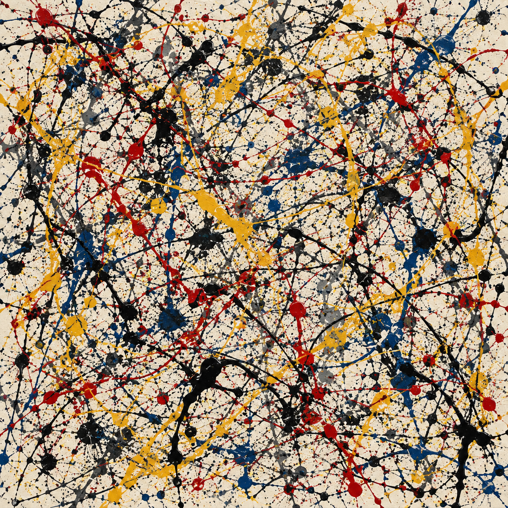 | 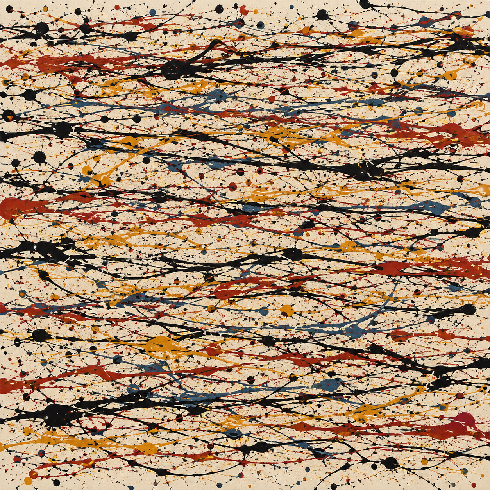 |
| Axis-coherence score: 0.029 | Axis-coherence score: 0.538 |

*Individual outputs from Image 2 with Pollock named. Axis coherence measures the strength of a preferred direction on a 0–1 scale. A separate measurement checked that the preferred direction was horizontal.*

## What we tested

The experiment used two service labels, `gpt-image-2` and `gpt-image-2.5-flare`, called Image 2 and Flare in the figures. Each received two prompt framings: “in the style of Jackson Pollock” and “using gestural drip-painting techniques.” These combinations formed four groups. The underlying model identities were unverified, so the labels identify access points within the tested service.

All prompts requested a square, all-over drip painting on a light neutral background, using English text without a reference image. Three templates varied the introductory wording. A fixed condition sentence then requested a low, medium, or high level of one visual property. Baseline prompts asked for a balanced composition with freely chosen colors, without specifying a feature level.

The analysis included 138 baseline images and 913 feature-directed images. Each image was measured in six ways:

| Requested property | Measurement |
| --- | --- |
| Detail across scales | Edge occupancy slope: how the number of grid boxes containing an edge changes as the boxes get smaller |
| Gaps and clustering | Mean log lacunarity: unevenness of dark-pixel coverage across moving windows |
| Paint coverage | Dark coverage: the fraction of pixels below a fixed brightness threshold |
| Directional alignment | Axis coherence: the strength of a preferred direction, calculated from changes in brightness |
| Enclosed spaces | Holes per megapixel: background regions enclosed by dark pixels |
| Palette diversity | Color-and-tone entropy: diversity in a histogram that groups pixels by lightness and color |

For comparison, the reference collection contained 31 Pollock reproductions and 40 works by Mark Tobey, Norman Bluhm, and Janet Sobel, mainly from WikiArt. The main comparison used the Pollocks; the other artists supplied context. [Prompts and source records][methods] provide the complete setup.

## Instructions produced clear changes

For Image 2 with Pollock named, mean axis coherence rose from approximately 0.04 to 0.57 between the low- and high-alignment instructions. The separate horizontal-alignment measurement confirmed the requested direction.

Clustering and color also changed. The examples below show how the instructions affected individual outputs.

| Requested property | Low level | High level |
| --- | --- | --- |
| Gaps and clustering | 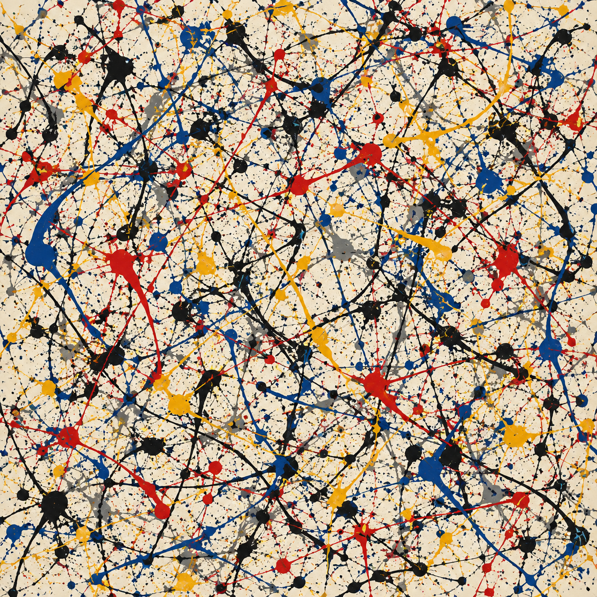 Log lacunarity: 0.147 | 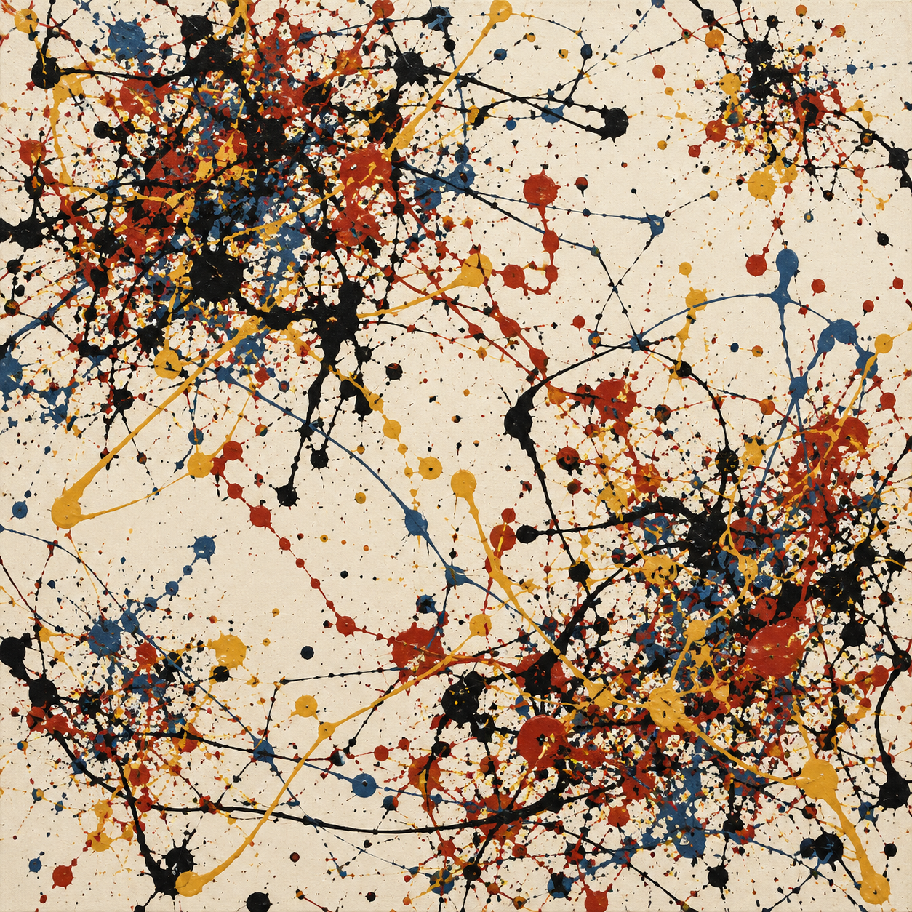 Log lacunarity: 0.414 |
| Palette diversity | 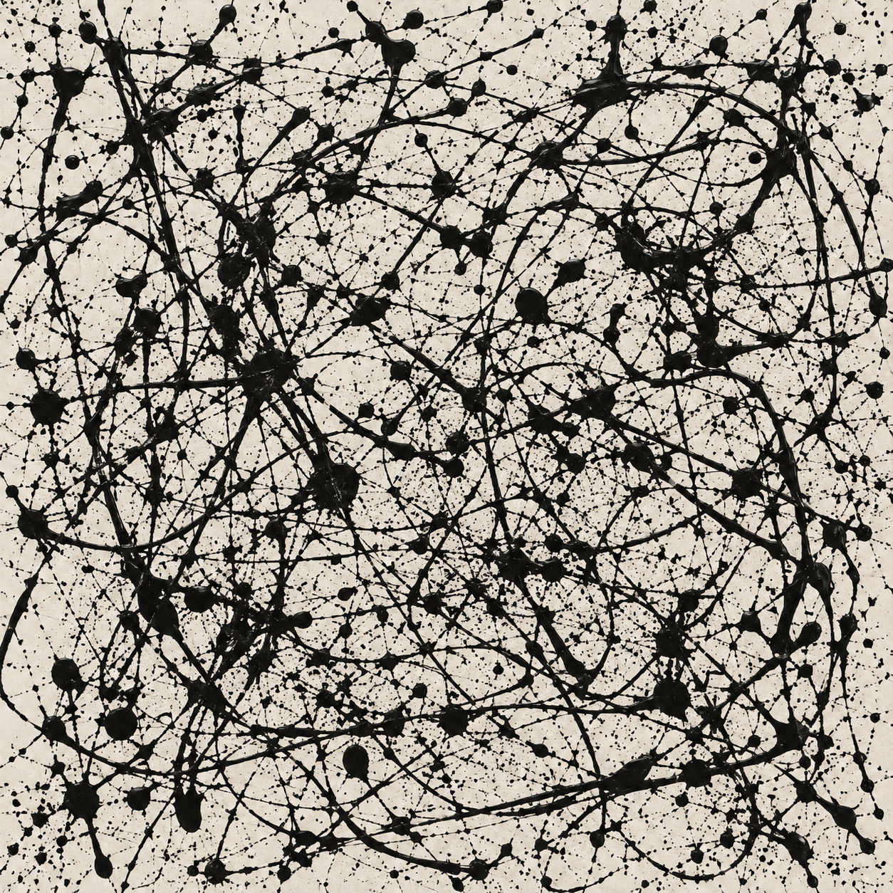 Color-and-tone entropy: 2.288 bits | 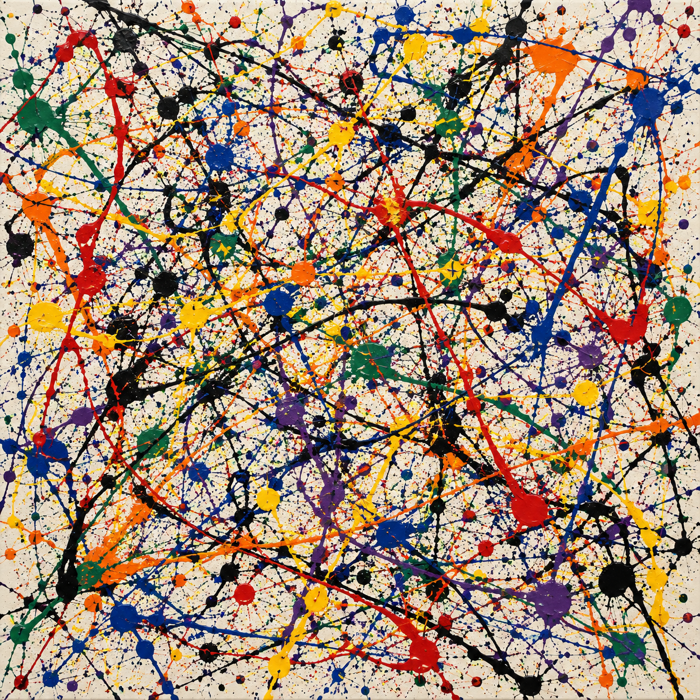 Color-and-tone entropy: 4.149 bits |

*Individual outputs from Image 2 with Pollock named. Higher lacunarity indicates more uneven dark-pixel coverage. Higher color-and-tone entropy indicates greater diversity in the histogram's lightness-and-color categories.*

The instructions were concrete. Alignment ranged from no preferred direction through a moderate horizontal preference to strong horizontal movement. The palette progressed from black only to three specified colors and then seven. The full prompt definitions are available [here][prompts].

Across the four groups, five measurements had positive trends: edge slope, lacunarity, axis coherence, enclosed spaces, and color-and-tone entropy. All 20 evaluable trends remained significant after correction across the 24 planned comparisons. The four density comparisons lacked enough high-level outputs. In 19 of the 20 evaluable comparisons, the means increased in low–medium–high order; one enclosed-space comparison dipped at the middle level. Excluding retry images retained all 20 positive trends. [Analysis results][effects]

[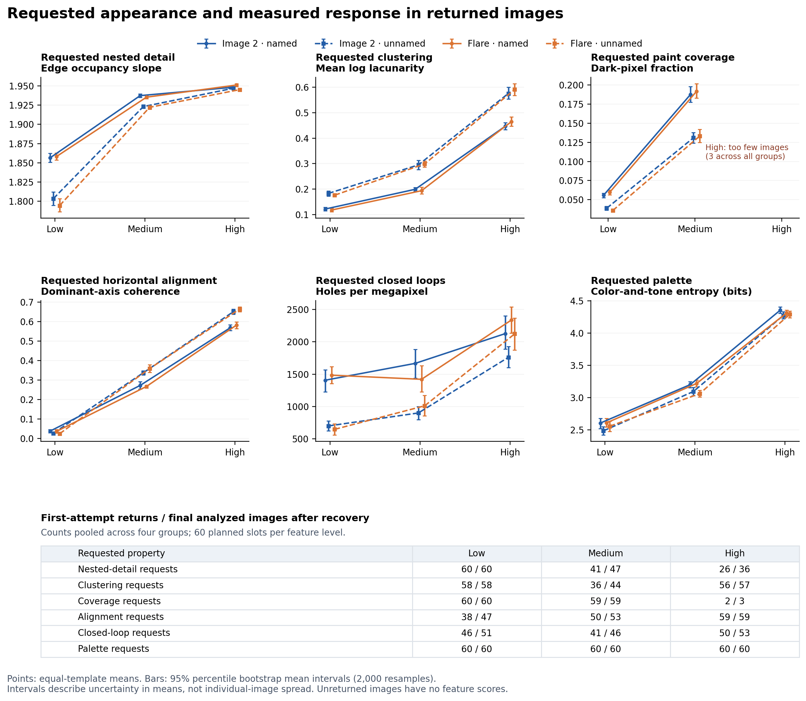](https://raw.githubusercontent.com/isingmodel/generative-art-feature-study/b36efa8fb4396aeb131e821e8aa328d48f3e4b7c/figures/blog/02_prompt_response.png)

*Figure 1. Points are means that give equal weight to the three templates; bars are 95% bootstrap intervals for those means. Each line represents one service-label/framing group. The count strip distinguishes initial returns from the final sample after recovery. High-density points are omitted because too few images returned.*

These results establish repeatable responses to the chosen instructions. Direction has the strongest direct support: both the general alignment score and the horizontal-specific check agree. The other measurements require closer attention to what changed in the image.

## What a rising score means

Adding finer trails can increase edge counts, dark coverage, and enclosed spaces together. Concentrating marks into clusters changes the distribution of both gaps and paint. Those connections appeared in the results: instructions aimed at one property often moved several measurements.

[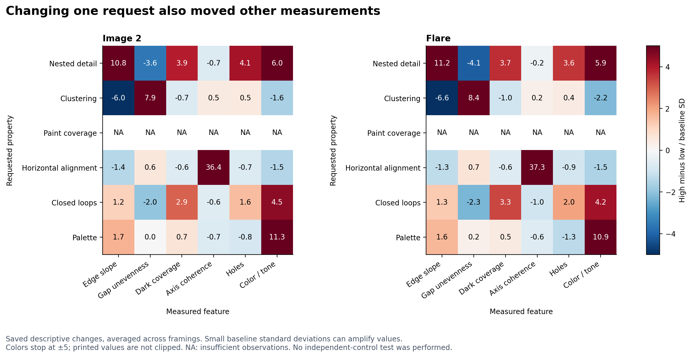](https://raw.githubusercontent.com/isingmodel/generative-art-feature-study/b36efa8fb4396aeb131e821e8aa328d48f3e4b7c/figures/blog/03_feature_spillovers.png)

*Figure 2. Rows are requested properties; columns are measurements. Red indicates an increase and blue a decrease. Values are descriptive changes in baseline standard-deviation units, averaged across framings. A narrow baseline spread makes these standardized changes larger. Shading stops at ±5; NA indicates insufficient observations.*

The edge-slope result illustrates why the measurement matters. In a procedural control, the same 256 identical black squares were either spread across an image or concentrated in one region. Simply changing their arrangement raised the slope from 1.03 to 1.73, while dark coverage and edge density stayed constant. The marks did not become smaller or more varied. [Procedural control results][controls]

The slope therefore responds to spatial arrangement as well as to changes in fine detail. It also loses sensitivity when the grid becomes fully occupied: all 36 high-detail outputs contained an edge in every box at the two coarsest sizes. More detail inside those boxes cannot increase their counts. The measured response is clear, but checking the requested nested structure requires an additional test.

Enclosed spaces have a related complication. Intersecting trails can surround background regions, so a denser network can increase the hole count. Likewise, color-and-tone entropy changes with lightness and relative area as well as palette. These are useful measurements, provided the evaluation checks whether they track the intended visual change.

The experiment asked for other properties to remain broadly balanced. A test of selective control would make that requirement explicit—for example, asking for more enclosed spaces while keeping dark coverage within a stated range.

## The baseline images occupied a narrow feature range

The baseline comparison asks how varied the outputs were without an explicit feature-level instruction. It compares 138 generated baselines with 31 Pollock reproductions, including the two works below.

| *Autumn Rhythm (Number 30)*, 1950 | *Number 1, 1950 (Lavender Mist)*, 1950 |
| --- | --- |
| 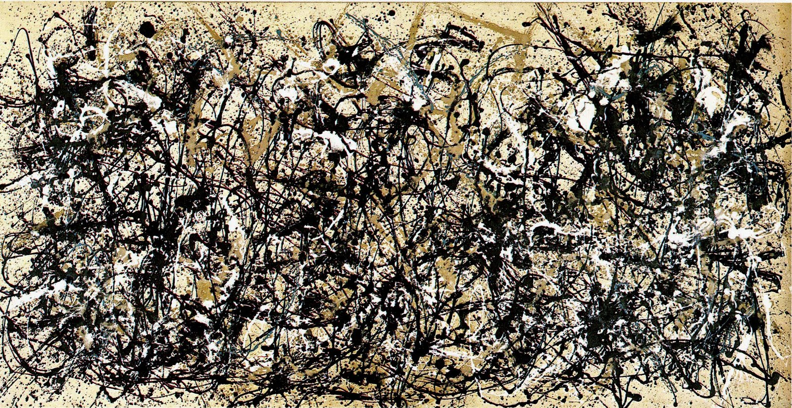 | 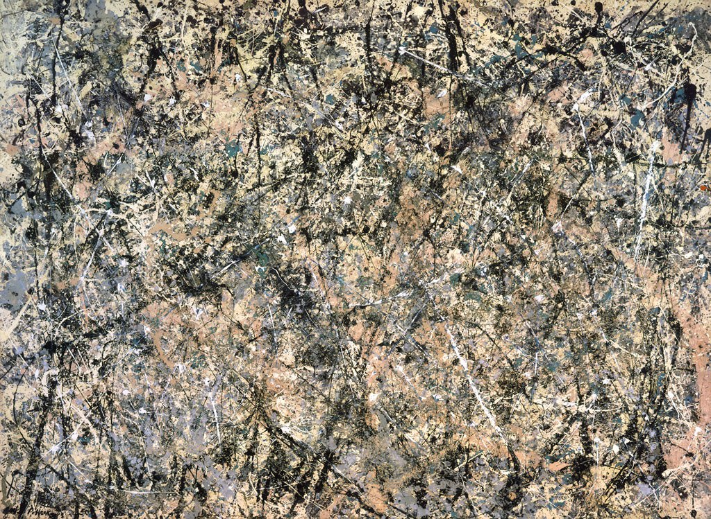 |
| [The Metropolitan Museum of Art][met] | [National Gallery of Art][nga] |

*WikiArt reproductions; the museum links identify the works.*

The generated baselines varied less on every measured feature. To show the difference, each generated group's standard deviation was divided by the Pollock sample's standard deviation. A ratio of 10% means one-tenth as much spread on that measurement.

[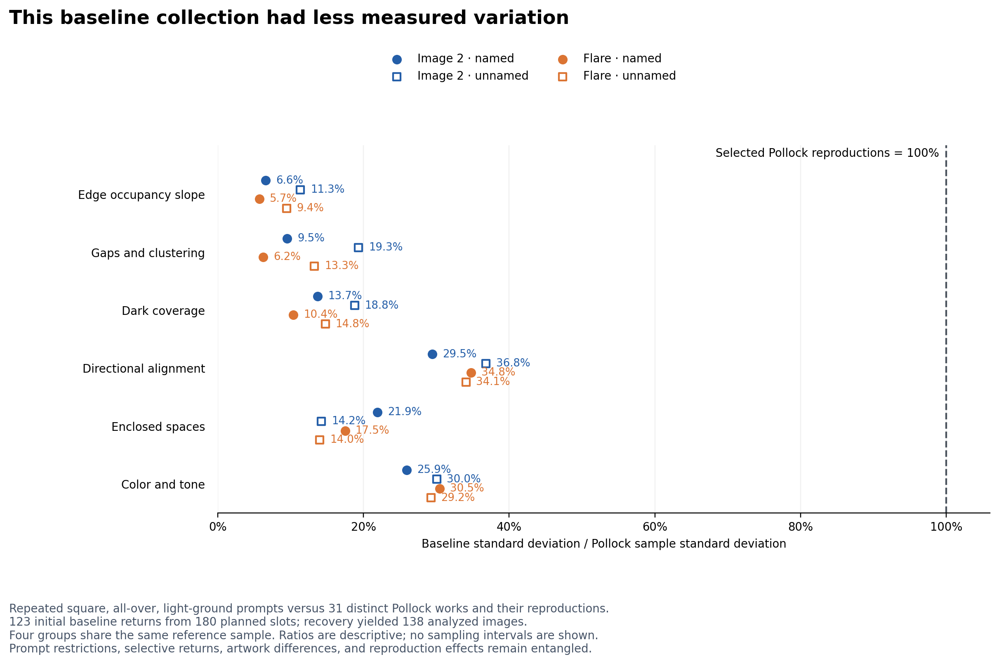](https://raw.githubusercontent.com/isingmodel/generative-art-feature-study/b36efa8fb4396aeb131e821e8aa328d48f3e4b7c/figures/blog/04_feature_diversity.png)

*Figure 3. Each point compares one baseline group's standard deviation with the same reference sample. Pollock is set to 100%. These are descriptive sample ratios; the figure includes baseline return counts and the comparison's prompt constraints.*

Baseline spread reached 5.7–11.3% of the reference spread for edge slope, 6.2–19.3% for lacunarity, 29.5–36.8% for alignment, and 25.9–30.5% for color and tone. On each individual measurement, most baseline images still fell within the reference sample's central 90% interval. [Spread ratios][spread-data] · [Individual-feature overlap][overlap-data]

Matching individual feature values and reproducing variation across a collection are separate achievements. Values can fall inside reference intervals while repeated outputs occupy a narrow part of them. Judging one image at a time can therefore miss how little of the reference collection's structural variety appears across many generations. The breadth of an artist's work matters alongside its recurring visual characteristics.

A plausible interpretation is that the shared prompts encourage a recurring compositional recipe. Individual trails can change while their aggregate coverage, clustering, direction, and color balance remain similar. Apparent randomness in the marks can coexist with consistency in the larger structure. Interpreting a style through a fixed balance of familiar features would reproduce its recognizable cues more readily than the differences among its works. This is a hypothesis suggested by the output distributions; the experiment does not identify the mechanism that produced them.

The feature-directed results show that several measurements can move when different appearances are explicitly requested. The narrow baseline therefore coexists with an ability to vary those properties. Responding to a requested variation and supplying that variation under repeated general instructions are different capabilities. For someone generating a collection, changing the requested composition may provide more structural variety than repeating similar wording.

The comparison brings together different sources of variation. The generated baselines share a square format, light background, all-over layout, and balanced-composition brief; the Pollock sample contains distinct historical works with varied reproduction conditions. Returns further select the generated sample: 123 of 180 initial requests returned images, rising to 138 after recovery. The observed gap concerns these conditions, with the contributions of prompting, generation, filtering, and reproduction still to be separated.

A useful next test would select reference works with comparable format and background, describe their contrasting visual properties, and generate repeated images for each description. This would separate variation within a prompt from variation introduced by changing it. Evaluation should examine how often different feature values occur and which combinations appear together. A few extreme outputs could widen the spread while leaving much of the reference distribution poorly represented. The goal is to recover a broader repertoire of measured structures, including their relationships, rather than simply maximize variance.

## Toward reliable control and a broader repertoire

The value of feature-based evaluation is making a visual request testable. This experiment found strong responses to concrete instructions, a narrow range under repeated baseline prompts, and large differences in completion across conditions. It also showed why a measurement needs to be checked against the visual property it is meant to describe.

The next step is to specify the desired outcome more precisely. A request for more enclosed spaces could require dark coverage to remain within a chosen range. Success would mean that an image returns, meets the enclosure target, and satisfies the coverage constraint. Independently written prompts would test whether the result carries over to new wording, and blinded human judgments would check that the intended change is visible.

A useful visual control should produce the requested change, preserve the stated constraints, and work reliably across attempts. At the collection level, evaluation should also ask whether repeated use represents a meaningful range of structures within the intended style. The direction results demonstrate a response to explicit instructions; the narrow baselines show why that response and the diversity of a generated collection need to be evaluated together.

## Methods and sources

[Methods and materials][methods] gives the preprocessing rules, statistical tests, sensitivity analyses, and source records. The [repository][research-repo] also provides [image-level measurements][data], [prompt definitions][prompts], and [procedural controls][controls]. The full generated-image corpus and raw request logs remain local, so the public material supports numerical reanalysis but only partial verification from source images.

The measurement choices draw on research into scale, clustering, color, and direction in Pollock's work. Useful background includes:

- Taylor, Micolich, and Jonas (1999), [Fractal analysis of Pollock's drip paintings][taylor].
- Jones-Smith, Mathur, and Krauss (2009), [Drip paintings and fractal analysis][jones-smith], on the limits of fractal criteria for authorship.
- Mureika, Dyer, and Cupchik (2005), [Multifractal structure in nonrepresentational art][mureika-structure], comparing paint regions and edges.
- Mureika (2005), [Fractal dimensions in perceptual color space][mureika-color], on the effects of color representation.
- Fairbanks et al. (2025), [A question of Jackson Pollock's balance][fairbanks], using lacunarity and fractal analysis in a controlled poured-painting study.
- Pedretti (2026), [Hidden evolving anisotropic order in Pollock's drip paintings][pedretti], using directional spatial analysis.

[methods]: https://github.com/isingmodel/generative-art-feature-study/blob/b36efa8fb4396aeb131e821e8aa328d48f3e4b7c/docs/methods.md
[prompts]: https://github.com/isingmodel/generative-art-feature-study/blob/b36efa8fb4396aeb131e821e8aa328d48f3e4b7c/src/design.py
[effects]: https://github.com/isingmodel/generative-art-feature-study/blob/b36efa8fb4396aeb131e821e8aa328d48f3e4b7c/results/primary/primary_effects.csv
[controls]: https://github.com/isingmodel/generative-art-feature-study/blob/b36efa8fb4396aeb131e821e8aa328d48f3e4b7c/results/metric_positive_controls.csv
[completion]: https://github.com/isingmodel/generative-art-feature-study/blob/b36efa8fb4396aeb131e821e8aa328d48f3e4b7c/results/collection_by_condition.csv
[spread-data]: https://github.com/isingmodel/generative-art-feature-study/blob/b36efa8fb4396aeb131e821e8aa328d48f3e4b7c/results/primary/fidelity_spread_ratios.csv
[overlap-data]: https://github.com/isingmodel/generative-art-feature-study/blob/b36efa8fb4396aeb131e821e8aa328d48f3e4b7c/results/primary/fidelity_features.csv
[data]: https://github.com/isingmodel/generative-art-feature-study/blob/b36efa8fb4396aeb131e821e8aa328d48f3e4b7c/results/features_primary.csv
[met]: https://www.metmuseum.org/art/collection/search/488978
[nga]: https://www.nga.gov/artworks/55819-number-1-1950-lavender-mist
[taylor]: https://www.nature.com/articles/20833
[jones-smith]: https://arxiv.org/abs/0710.4917
[mureika-structure]: https://arxiv.org/abs/physics/0506063
[mureika-color]: https://arxiv.org/abs/physics/0509152
[fairbanks]: https://www.frontiersin.org/journals/physics/articles/10.3389/fphy.2025.1673780/full
[pedretti]: https://www.nature.com/articles/s40494-026-02519-2

[research-repo]: https://github.com/isingmodel/generative-art-feature-study
