AI에게 “잭슨 폴록 스타일로 그려 달라”고 주문할 때, 선이나 물감 자국이 그럴듯한지만 봐서는 놓치는 것이 있다. 그림을 여러 장 만들었을 때 구도와 색, 물감이 흩어진 모습도 충분히 달라지는지다.

이 실험에서는 AI가 만든 드립 페인팅 1,051장을 분석했다. 물감을 흘리거나 떨어뜨려 그리는 그림에서, “선을 수평으로 그려 달라”거나 “물감 자국을 한곳에 모아 달라”는 주문이 얼마나 통하는지 확인했다. 이런 주문 없이 만든 그림들은 선정된 폴록 작품 이미지들과 비교했다.

## 그림의 특징을 숫자로 비교하기

작품을 촬영하거나 스캔한 이미지는 색과 밝기 정보가 담긴 픽셀로 이루어진다. 이 정보를 이용하면 그림에서 어두운 부분이 차지하는 면적, 선이 향하는 방향, 물감 자국 사이의 빈틈 등을 측정할 수 있다.

픽셀이 100개인 흑백 이미지 두 장을 생각해 보자. 둘 다 검은 픽셀이 30개라면 어두운 부분의 비율은 똑같이 30%다. 그래도 한쪽에서는 검은 픽셀이 덩어리로 모여 있고, 다른 쪽에서는 수평선을 이룰 수 있다. 면적만 재서는 두 그림의 차이를 설명하기 어렵다. 물감 자국이 얼마나 뭉쳐 있는지, 어느 방향으로 놓여 있는지도 함께 봐야 한다.

여러 작품을 비교할 때는 각 측정값이 얼마나 달라지는지도 중요하다. 평균적으로는 비슷한 양의 물감이 쓰였더라도, 한쪽에는 성긴 그림과 빽빽한 그림이 고루 있고 다른 쪽에는 비슷한 밀도의 그림만 있을 수 있다. 한 장의 특징과 여러 장 사이의 차이를 따로 살펴보려는 이유다.

폴록의 작품은 오래전부터 이런 방식으로 연구되어 왔다. [Taylor, Micolich, Jonas][taylor]는 그림 위에 격자를 놓고 물감 무늬가 걸쳐 있는 칸을 세는 ‘박스 카운팅’으로 프랙탈 구조가 나타난다고 보고했다. 격자의 크기를 바꿔 가며 같은 계산을 반복해, 크고 작은 무늬가 공간을 어떻게 채우는지 살피는 방법이다. 이후에는 [물감이 차지하는 영역과 그 경계][mureika-structure], [색상을 표현하는 방식의 영향][mureika-color], [물감을 부어 그린 그림의 군집과 빈틈][fairbanks], [폴록 작품의 방향성][pedretti]을 다룬 연구도 나왔다.

## 구체적으로 주문하자 그림이 달라졌다

먼저 가장 뚜렷한 결과부터 보자. 아래 두 그림 중 왼쪽은 선이 여러 방향으로 뻗도록, 오른쪽은 수평 방향이 강하게 드러나도록 주문한 결과다.

| 여러 방향으로 뻗는 선을 요청 | 수평 방향이 두드러지는 선을 요청 |
| --- | --- |
| 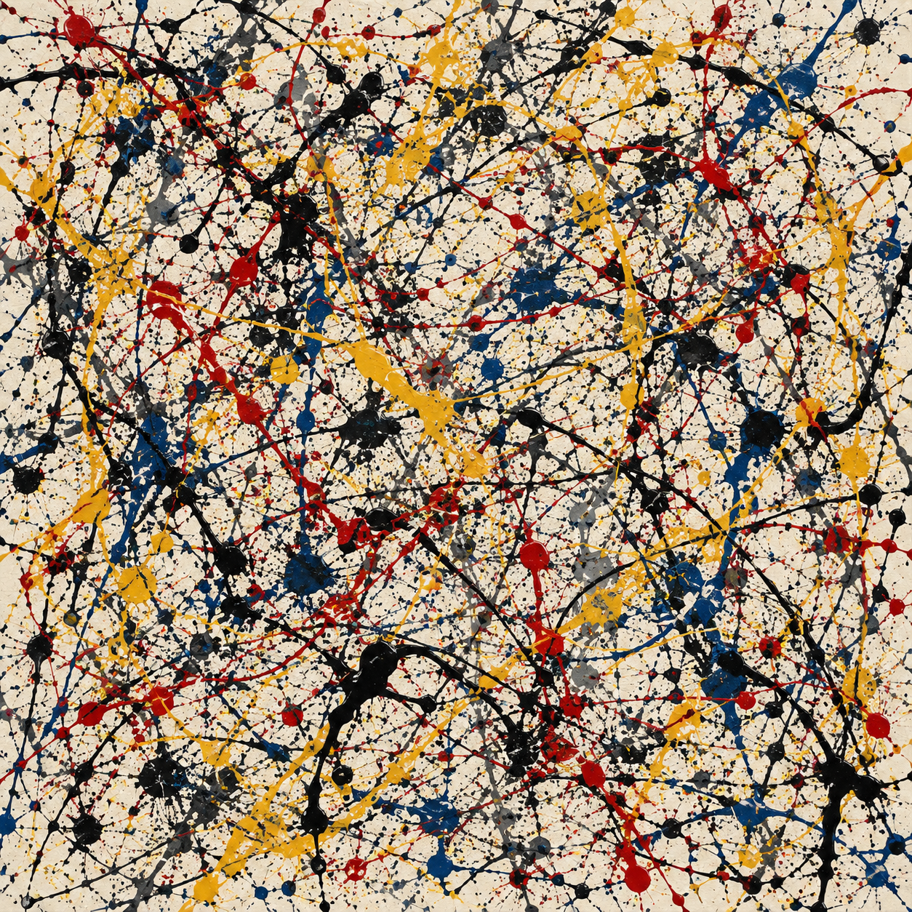 | 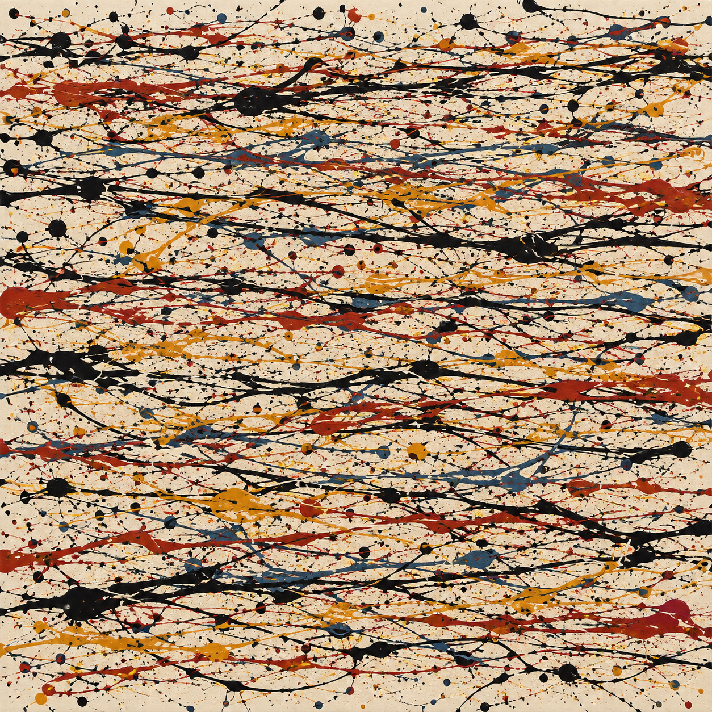 |
| 방향 정렬도: 0.029 | 방향 정렬도: 0.538 |

*폴록의 이름을 넣은 Image 2 조건에서 고른 예시다. 방향 정렬도는 선이 특정 방향으로 얼마나 나란히 놓여 있는지 나타낸다. 0에서 1 사이의 값이며, 클수록 한 방향이 뚜렷하다. 그 방향이 실제로 수평인지도 별도로 확인했다.*

물감 자국을 불균일하게 모아 달라거나 더 많은 색을 써 달라는 주문에도 관련 측정값이 달라졌다. 다만 한 가지를 바꾸는 동안 다른 특징도 함께 바뀌는 경우가 많았다.

구체적인 주문을 하지 않은 그림들에서는 다른 결과가 눈에 띄었다. 여섯 측정값 모두에서 그림 사이의 차이가 폴록 작품 이미지들보다 작았다. 원하는 변화를 주문했을 때 따라오는지와, 같은 주문으로 여러 장을 만들었을 때 얼마나 다양한 그림이 나오는지를 함께 살펴볼 필요가 있었다.

## 어떤 조건으로 비교했나

이미지는 `gpt-image-2`와 `gpt-image-2.5-flare`라는 서비스 이름으로 요청했다. 도표에서는 각각 Image 2와 Flare로 줄여 썼다. 실제 내부 모델은 확인하지 못했으므로, 이 글에서는 두 이름을 서비스를 구분하는 용도로만 쓴다.

각 서비스에서 폴록의 이름을 넣은 프롬프트와, 작가 이름 없이 드립 페인팅 기법을 설명한 프롬프트를 사용했다. 이렇게 두 서비스와 두 표현을 조합해 네 집단을 만들었다. 도표의 named는 폴록의 이름을 넣은 조건, unnamed는 넣지 않은 조건이다.

프롬프트는 모두 영어로 작성했고 참고 이미지는 주지 않았다. 공통으로 밝은 중성색 바탕의 정사각형 그림을 요청했으며, 물감 자국이 화면 전체에 펼쳐지도록 했다. 도입 문장을 세 가지로 바꿔 사용하되, 같은 수준의 특징을 요청하는 문장은 똑같이 유지했다.

비교는 크게 두 종류였다. 하나는 각 특징을 낮음, 중간, 높음으로 나누어 요청하는 조건이다. 다른 하나는 특정 특징을 지정하지 않고 “균형 잡힌 구도와 자유롭게 선택한 색”만 요청하는 **기본 조건**이다. 분석에는 기본 조건의 이미지 138장과 특징을 지정한 이미지 913장이 들어갔다.

각 이미지에서 다음 여섯 가지를 측정했다.

| 살펴본 특징 | 측정 방법 |
| --- | --- |
| 크고 작은 무늬의 분포 | **에지 점유 기울기**: 격자를 잘게 나눌수록 윤곽선이 걸쳐 있는 칸의 수가 얼마나 빠르게 늘어나는지 계산했다. 에지는 밝기가 급격히 바뀌는 경계를 뜻한다. |
| 물감 자국의 뭉침과 빈틈 | **평균 로그 라쿠나리티**: 작은 창을 이미지 위로 옮겨 가며, 어두운 픽셀이 고르게 퍼져 있는지 한곳에 몰려 있는지 측정했다. |
| 물감이 덮는 면적 | **어두운 픽셀의 비율**: 밝기가 정해진 기준보다 낮은 픽셀이 전체에서 차지하는 비율을 구했다. |
| 선이 향하는 방향 | **방향 정렬도**: 밝기 변화를 이용해 특정 방향이 얼마나 뚜렷한지 계산했다. |
| 선으로 둘러싸인 공간 | **100만 픽셀당 폐쇄 영역 수**: 어두운 픽셀에 둘러싸인 배경 영역이 몇 개인지 셌다. |
| 색과 밝기의 다양성 | **색상과 명도의 엔트로피**: 픽셀을 색과 밝기에 따라 나눈 뒤, 여러 구간에 얼마나 고르게 분포하는지 계산했다. |

비교 자료는 주로 WikiArt에서 구한 폴록 작품 이미지 31장이었다. 마크 토비, 노먼 블룸, 재닛 소벨의 작품 이미지 40장도 참고 자료로 사용했다. 자세한 조건은 [실험 방법과 자료][methods]에 정리했다.

## 방향뿐 아니라 뭉침과 색도 바꿀 수 있었다

폴록의 이름을 넣은 Image 2 조건에서, 방향 정렬을 낮게 요청한 그림들의 평균 정렬도는 약 0.04였다. 높게 요청했을 때는 약 0.57로 올랐다. 수평 방향만 따로 측정해도 주문한 변화가 나타났다.

물감 자국의 뭉침과 색을 바꿔 달라고 했을 때는 다음과 같은 그림을 얻었다.

| 주문한 특징 | 낮은 수준을 요청 | 높은 수준을 요청 |
| --- | --- | --- |
| 물감 자국의 뭉침과 빈틈 | 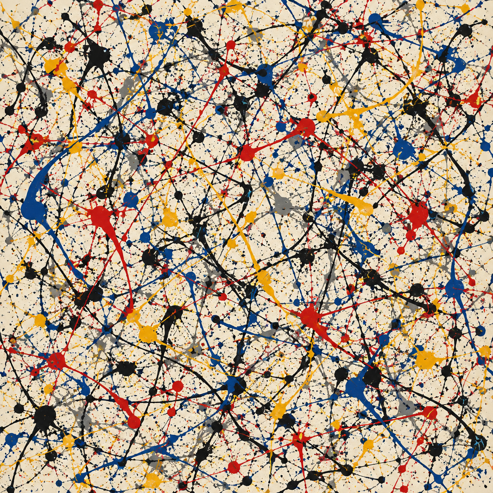 로그 라쿠나리티: 0.147 | 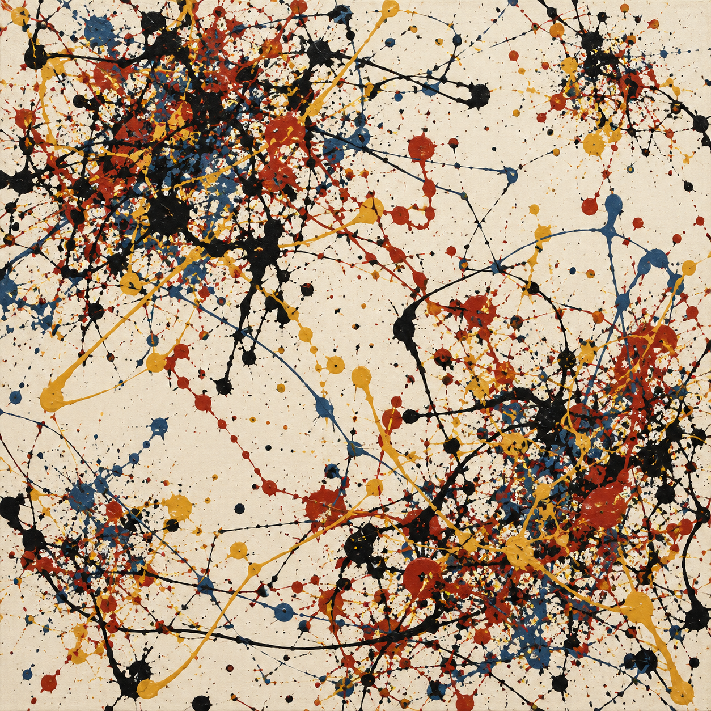 로그 라쿠나리티: 0.414 |
| 색의 다양성 | 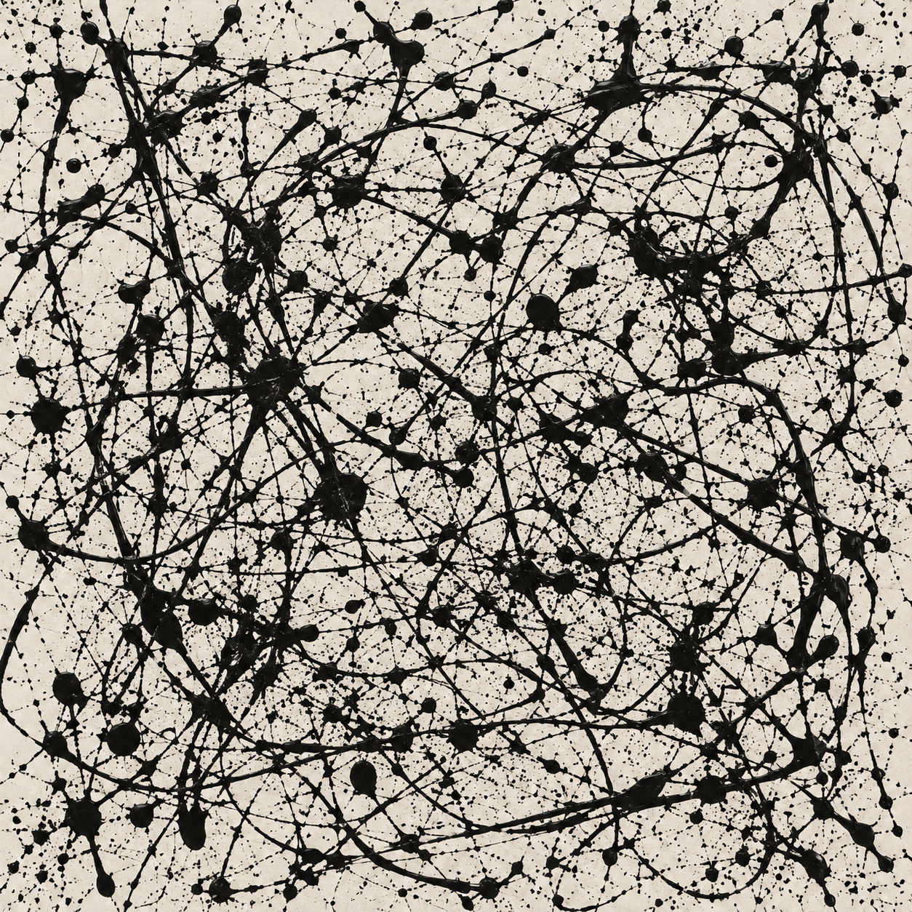 색상과 명도의 엔트로피: 2.288비트 | 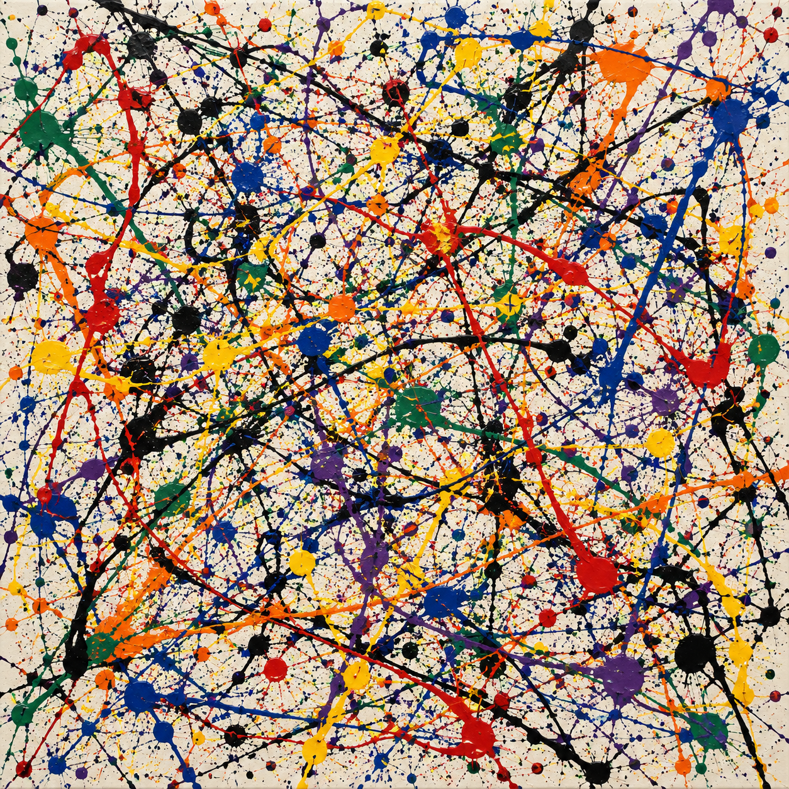 색상과 명도의 엔트로피: 4.149비트 |

*폴록의 이름을 넣은 Image 2 조건의 개별 예시다. 라쿠나리티가 높으면 어두운 픽셀의 분포가 더 불균일하다. 색상과 명도의 엔트로피가 높으면 픽셀이 더 다양한 색과 밝기 구간에 퍼져 있다.*

프롬프트에는 “높게”나 “낮게”만 적은 것이 아니라, 원하는 모습을 구체적으로 설명했다. 방향은 ‘여러 방향으로 뻗는 선’, ‘수평을 어느 정도 선호하는 선’, ‘수평으로 강하게 정렬된 선’으로 나눴다. 색은 검정만 쓰도록 한 조건에서, 지정한 세 가지 색, 일곱 가지 색을 쓰도록 한 조건으로 늘렸다. 실제 문장은 [프롬프트 정의][prompts]에서 볼 수 있다.

여섯 특징을 네 집단에서 비교하므로 원래 계획한 비교는 24개였다. 이 중 물감이 덮는 면적에 관한 네 비교는 평가할 수 없었다. 화면을 빽빽하게 채우라고 요청한 조건에서 받은 이미지가 너무 적었기 때문이다. 이 조건에서는 첫 요청 60건 중 2장만 받았고, 재시도 후에도 3장에 그쳤다. 실패 원인은 이 결과만으로 알 수 없다. [이미지 수집 결과][completion]

평가할 수 있었던 나머지 20개 비교에서는 모두 요청 수준에 따라 측정값이 올라가는 경향이 나타났다. 여러 비교를 한꺼번에 할 때 우연한 차이를 유의한 결과로 판단할 가능성을 줄이는 보정을 적용한 뒤에도 통계적으로 유의했다. 20개 중 19개는 평균도 낮음, 중간, 높음 순서로 증가했다. 나머지 하나는 폐쇄 영역 수를 비교한 경우로, 중간 수준의 평균이 낮은 수준보다 작았다. 재시도로 얻은 이미지를 제외해도 20개의 상승 경향은 유지됐다. [분석 결과][effects]

[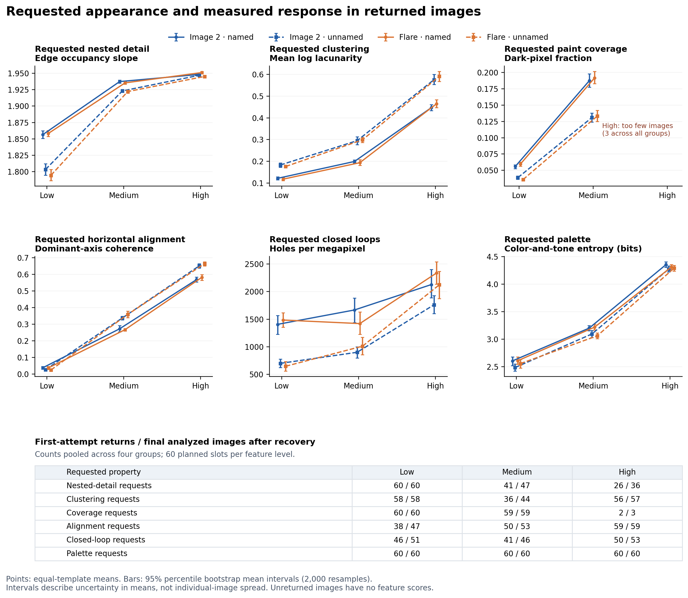](https://raw.githubusercontent.com/isingmodel/generative-art-feature-study/b36efa8fb4396aeb131e821e8aa328d48f3e4b7c/figures/blog/02_prompt_response.png)

*그림 1. 점은 세 도입 문장의 결과를 같은 비중으로 반영한 평균이고, 막대는 평균의 불확실성을 나타내는 95% 부트스트랩 신뢰구간이다. 각 선은 네 집단 중 하나다. 아래 표에는 첫 요청에서 받은 이미지 수와 재시도 후의 최종 수를 표시했다. 화면을 빽빽하게 채우라고 한 조건은 이미지가 부족해 평균을 표시하지 않았다. 그림을 누르면 크게 볼 수 있다.*

## 선이 빽빽해지면 여러 측정값이 함께 바뀐다

이제 측정값이 올라간 이유를 살펴볼 차례다. 가는 선을 더 그리면 윤곽선도 늘고, 어두운 부분도 넓어지고, 선에 둘러싸인 공간도 많아질 수 있다. 실제로 한 가지 특징을 바꾸라는 주문에 여러 측정값이 함께 반응했다.

[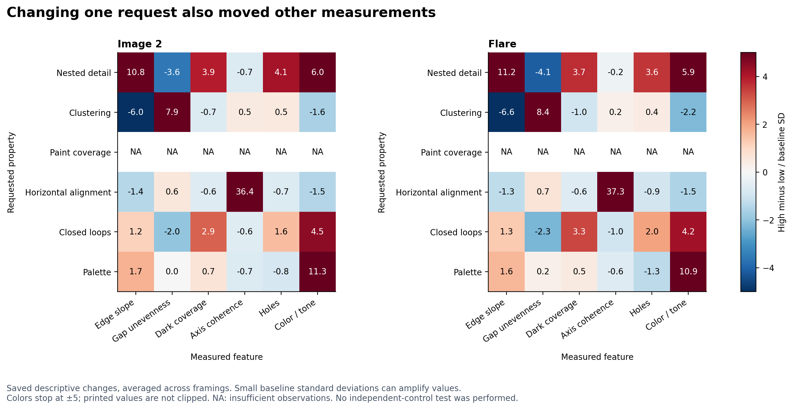](https://raw.githubusercontent.com/isingmodel/generative-art-feature-study/b36efa8fb4396aeb131e821e8aa328d48f3e4b7c/figures/blog/03_feature_spillovers.png)

*그림 2. 행은 주문한 특징, 열은 측정 항목이다. 빨강은 증가, 파랑은 감소를 뜻한다. 변화량은 기본 조건의 표준편차를 단위로 환산한 뒤, 폴록 이름을 넣은 조건과 넣지 않은 조건의 결과를 평균했다. 기본 조건의 그림들이 비슷할수록 표준편차가 작아져, 같은 변화도 큰 값으로 표시된다. 색의 진하기는 변화량 ±5까지 구분하며, NA는 이미지가 부족한 경우다.*

에지 점유 기울기를 보면 이 문제가 잘 드러난다. 검증용으로 같은 크기의 검은 정사각형 256개를 화면에 흩어 놓은 이미지와 한곳에 모아 놓은 이미지를 만들었다. 배치만 바꿨는데 기울기가 1.03에서 1.73으로 올랐다. 어두운 픽셀의 비율과 윤곽선의 밀도는 그대로였고, 더 작거나 다양한 정사각형을 넣은 것도 아니었다. 이 값은 무늬의 세부 모양뿐 아니라 배치에도 영향을 받는다. [검증용 이미지의 측정 결과][controls]

격자의 모든 칸에 윤곽선이 들어가면 그 뒤의 차이도 잡아내기 어렵다. ‘높은 복잡도’를 주문해 얻은 이미지 36장은 모두 가장 큰 두 격자 크기에서 모든 칸이 채워졌다. 그 안에 가는 선을 더 그려도 칸의 수는 늘지 않는다. 큰 무늬 안에 작은 무늬가 겹겹이 생겼는지 확인하려면 다른 검사도 필요하다.

폐쇄 영역 수와 색의 엔트로피도 비슷하게 읽어야 한다. 선이 빽빽하게 교차하기만 해도 둘러싸인 공간이 늘어날 수 있다. 색의 엔트로피는 사용한 색의 가짓수뿐 아니라 밝기와 각 색이 차지하는 면적에도 달라진다. 수치가 변했다면 그림에서 무엇이 바뀌었는지 함께 확인해야 한다.

## 기본 프롬프트로 만든 그림들은 서로 얼마나 달랐나

이번에는 특징을 따로 지정하지 않은 기본 조건의 이미지 138장을 보자. 비교 대상은 아래 두 작품을 포함한 폴록 작품 이미지 31장이다.

| 〈가을 리듬(넘버 30)〉, 1950년 | 〈넘버 1, 1950(라벤더 미스트)〉, 1950년 |
| --- | --- |
| 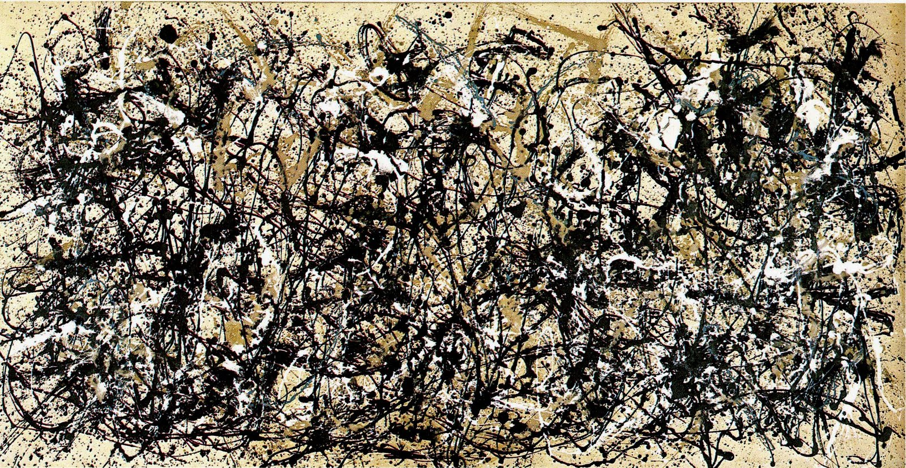 | 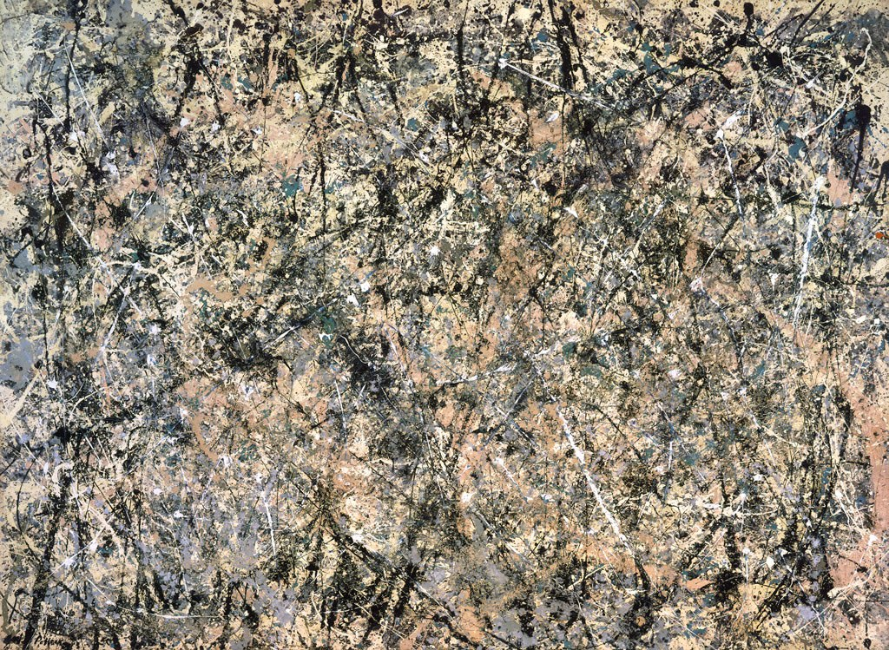 |
| [메트로폴리탄 미술관][met] | [미국 국립미술관][nga] |

*이미지는 WikiArt에서 가져왔다. 미술관 링크는 각 작품의 소장 정보를 제공한다.*

그림들 사이의 차이를 비교하기 위해 **표준편차**를 사용했다. 측정값이 그림마다 크게 다르면 표준편차가 크고, 비슷비슷하면 작다. 폴록 작품 이미지들의 표준편차를 100%로 놓고, 생성 이미지들의 표준편차가 그에 비해 얼마나 되는지 계산했다. 10%라면 폴록 표본의 10분의 1이라는 뜻이다.

[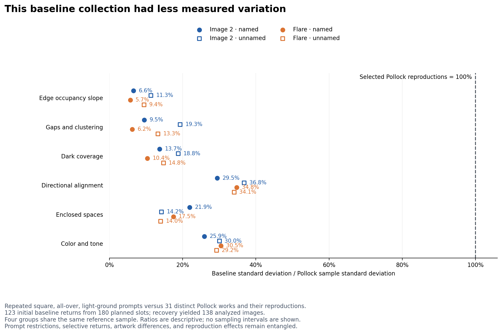](https://raw.githubusercontent.com/isingmodel/generative-art-feature-study/b36efa8fb4396aeb131e821e8aa328d48f3e4b7c/figures/blog/04_feature_diversity.png)

*그림 3. 각 점은 네 생성 집단 중 하나를 나타낸다. 폴록 표본을 기준으로 삼아 여섯 측정값의 표준편차를 비교했다. 기본 조건에서 받은 이미지 수와 프롬프트의 공통 조건도 표시했다.*

여섯 항목 모두 생성 이미지들의 표준편차가 더 작았다. 네 집단에서 나온 비율의 최솟값과 최댓값은 다음과 같다.

| 측정 항목 | 가장 작은 비율 | 가장 큰 비율 |
| --- | --- | --- |
| 에지 점유 기울기 | 5.7% | 11.3% |
| 물감 자국의 뭉침과 빈틈(라쿠나리티) | 6.2% | 19.3% |
| 어두운 픽셀의 비율 | 10.4% | 18.8% |
| 방향 정렬도 | 29.5% | 36.8% |
| 폐쇄 영역 수 | 14.0% | 21.9% |
| 색상과 명도의 엔트로피 | 25.9% | 30.5% |

*모두 폴록 표본의 표준편차를 100%로 놓고 계산한 값이다. 최솟값과 최댓값은 네 생성 집단 사이의 범위이며, 신뢰구간을 뜻하지 않는다. [표준편차 비율 원자료][spread-data]*

그렇다고 생성 이미지의 측정값이 폴록 작품들과 동떨어져 있었던 것은 아니다. 측정값을 하나씩 보면 대부분은 폴록 표본의 중앙 90% 구간 안에 들어갔다. 이는 양 끝의 5%씩을 제외한 범위다. [개별 측정값의 범위 중첩][overlap-data]

이 두 결과는 함께 나타날 수 있다. 예를 들어 폴록 작품에는 성긴 그림부터 빽빽한 그림까지 있어도, 생성 이미지는 그 중간의 비슷한 밀도에 모일 수 있다. 한 장씩 보면 폴록 작품에서 볼 수 있는 값이지만, 여러 장을 모아 보면 작품들 사이의 차이까지 따라 하지는 못하는 것이다.

## 이 차이는 어디서 왔을까

공통으로 준 조건이 결과를 비슷하게 만들었을 가능성이 있다. 선 하나하나의 모양은 달라져도, 정사각형 화면을 밝은 바탕 위에 균형 있게 채우라는 주문을 반복하면 물감의 양이나 배치가 비슷해질 수 있다. 실제로 무엇이 원인이었는지는 이번 실험만으로 알 수 없다.

비교 조건도 같지 않았다. 생성 이미지에는 화면 형태와 배경, 구도에 공통된 제약을 뒀지만, 폴록 표본은 서로 다른 시기에 그린 작품들이다. 작품을 촬영하거나 디지털 이미지로 옮긴 조건도 제각각이다. 따라서 이번 차이를 그대로 AI 그림 전체의 다양성 한계라고 볼 수는 없다.

또한 분석에는 실제로 받은 이미지만 들어갔다. 기본 조건의 첫 요청 180건에서는 123장을 받았고, 재시도 후 138장이 됐다. 어떤 이미지가 생성되고 어떤 요청이 실패했는지도 결과에 영향을 줄 수 있다.

후속 실험에서는 화면 형태와 배경이 비슷한 폴록 작품들을 고른 뒤, 작품마다 다른 구도와 물감 배치를 문장으로 설명해 볼 수 있다. 각 설명으로 이미지를 여러 장 만들면, 같은 주문 안에서 생기는 차이와 주문을 바꿔서 생기는 차이를 나누어 볼 수 있다.

평가할 때는 표준편차만 키우는 데 그쳐서도 안 된다. 아주 성긴 그림이나 아주 빽빽한 그림 몇 장만 있어도 표준편차는 커질 수 있다. 중간의 여러 밀도가 고루 나오는지, 밀도와 색, 방향이 어떤 조합으로 나타나는지까지 봐야 한다.

## 원하는 부분을 바꾸면서 다른 조건도 지킬 수 있을까

이번 실험에서는 원하는 모습을 구체적으로 설명하면 여러 측정값을 바꿀 수 있었다. 특히 수평 방향을 주문한 결과는 눈으로 본 모습과 두 종류의 방향 측정이 잘 맞았다. 앞으로 확인할 것은 다른 특징을 일정하게 유지하면서도 이런 변화를 얻을 수 있는지다.

가령 “선으로 둘러싸인 공간을 늘리되, 어두운 부분의 면적은 정해진 범위에 유지해 달라”고 요청할 수 있다. 이 경우에는 이미지를 받았는지, 둘러싸인 공간이 늘었는지, 면적 조건을 지켰는지를 함께 확인해야 한다. 같은 뜻을 다른 문장으로 주문해도 결과가 유지되는지도 시험할 수 있다.

사람이 보기에 의도한 변화가 드러나는지도 중요하다. 어떤 주문으로 만든 그림인지 모르는 사람들에게 이미지를 보여 주고 판단하게 하면, 측정값과 눈으로 본 변화가 일치하는지 확인할 수 있다. 여러 장을 만들 때는 각 그림이 주문을 따르는지와 함께, 그림들 사이에 얼마나 다양한 차이가 생기는지도 살펴야 한다.

## 방법과 자료

전처리 규칙과 통계 검정, 조건을 바꿔 다시 분석한 결과는 [실험 방법과 자료][methods]에 정리했다. [분석 저장소][research-repo]에는 [이미지별 측정값][data], [프롬프트 정의][prompts], [검증용 이미지의 측정 결과][controls]가 있다. 전체 생성 이미지와 원시 요청 로그는 로컬 작업 공간에 보관하고 있다. 공개한 측정값으로 수치 분석을 다시 할 수 있지만, 모든 원본 이미지에서 측정이 맞았는지까지 검증할 수는 없다.

측정 항목을 정할 때 참고한 연구는 다음과 같다.

- Taylor, Micolich, Jonas (1999), [Fractal analysis of Pollock's drip paintings][taylor].
- Jones-Smith, Mathur, Krauss (2009), [Drip paintings and fractal analysis][jones-smith]. 프랙탈 기준으로 작품의 작가를 판별할 때 생기는 한계를 다룬다.
- Mureika, Dyer, Cupchik (2005), [Multifractal structure in nonrepresentational art][mureika-structure]. 물감이 차지하는 영역과 그 경계를 비교한다.
- Mureika (2005), [Fractal dimensions in perceptual color space][mureika-color]. 색상을 표현하는 방식이 측정에 미치는 영향을 다룬다.
- Fairbanks 외 (2025), [A question of Jackson Pollock's balance][fairbanks]. 통제된 조건에서 물감을 부어 그린 그림에 라쿠나리티와 프랙탈 분석을 적용한다.
- Pedretti (2026), [Hidden evolving anisotropic order in Pollock's drip paintings][pedretti]. 방향에 따른 공간 구조를 분석한다.

[methods]: https://github.com/isingmodel/generative-art-feature-study/blob/b36efa8fb4396aeb131e821e8aa328d48f3e4b7c/docs/methods.ko.md
[prompts]: https://github.com/isingmodel/generative-art-feature-study/blob/b36efa8fb4396aeb131e821e8aa328d48f3e4b7c/src/design.py
[effects]: https://github.com/isingmodel/generative-art-feature-study/blob/b36efa8fb4396aeb131e821e8aa328d48f3e4b7c/results/primary/primary_effects.csv
[controls]: https://github.com/isingmodel/generative-art-feature-study/blob/b36efa8fb4396aeb131e821e8aa328d48f3e4b7c/results/metric_positive_controls.csv
[completion]: https://github.com/isingmodel/generative-art-feature-study/blob/b36efa8fb4396aeb131e821e8aa328d48f3e4b7c/results/collection_by_condition.csv
[spread-data]: https://github.com/isingmodel/generative-art-feature-study/blob/b36efa8fb4396aeb131e821e8aa328d48f3e4b7c/results/primary/fidelity_spread_ratios.csv
[overlap-data]: https://github.com/isingmodel/generative-art-feature-study/blob/b36efa8fb4396aeb131e821e8aa328d48f3e4b7c/results/primary/fidelity_features.csv
[data]: https://github.com/isingmodel/generative-art-feature-study/blob/b36efa8fb4396aeb131e821e8aa328d48f3e4b7c/results/features_primary.csv
[met]: https://www.metmuseum.org/art/collection/search/488978
[nga]: https://www.nga.gov/artworks/55819-number-1-1950-lavender-mist
[taylor]: https://www.nature.com/articles/20833
[jones-smith]: https://arxiv.org/abs/0710.4917
[mureika-structure]: https://arxiv.org/abs/physics/0506063
[mureika-color]: https://arxiv.org/abs/physics/0509152
[fairbanks]: https://www.frontiersin.org/journals/physics/articles/10.3389/fphy.2025.1673780/full
[pedretti]: https://www.nature.com/articles/s40494-026-02519-2

[research-repo]: https://github.com/isingmodel/generative-art-feature-study
