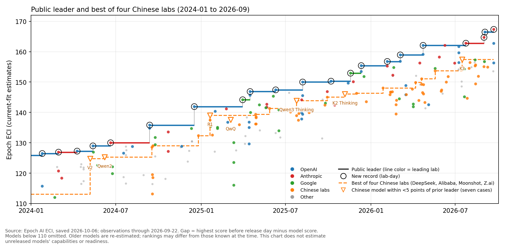
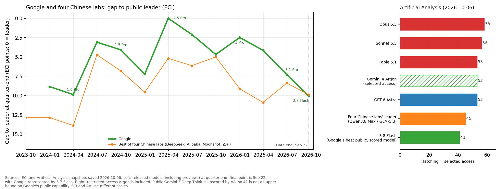

On January 27, 2025, DeepSeek R1's arrival fueled doubts about whether AI development needed enormous investment. Nvidia's market value [fell](https://seekingalpha.com/news/4399000-nvidia-broadcom-lead-tech-stocks-lower-amid-deepseek-ai-impact) by about $590 billion in a single day. OpenAI already had o3 in reserve. Just over a month earlier, it had [announced](https://tech.yahoo.com/computing/articles/openai-teases-breakthrough-next-generation-232702883.html) a score of 71.7% on the coding benchmark SWE-bench Verified, but ordinary users could not yet use the model.

R1 was a substantial achievement. On Epoch AI's capability index, ECI, it was 2.9 points behind o1, the public leader at the time. Both, however, were products users could access. If a lab has a stronger unreleased model, the actual capability gap may be wider than the public ranking suggests. R1's proximity to the public leader alone does not establish that advanced chips have lost their advantage at the frontier.

On April 7, 2026, Anthropic made [Mythos Preview](https://www.anthropic.com/glasswing) available only to cyber defense partners. Nine days later, it released [Opus 4.7](https://www.anthropic.com/news/claude-opus-4-7) to the public. The company said Opus 4.7 was less capable overall than Mythos and that it would begin testing safeguards with this model. Even when a lab has a highly capable model, more preparation may be needed before ordinary users can access it. Assessing chip controls requires looking at circumstances that rankings leave out.

## What happened after Chinese models drew close?

Of the 22 new ECI records from March 2023 through September 22, 2026, none belonged to a Chinese lab. At the final observation, the best model from the four Chinese labs compared here—DeepSeek, Alibaba, Moonshot, and Z.ai—was about 10 points below the public leader. At the leader's recent rate of improvement, that amounts to roughly eight months. This expresses a score gap in units of time; it does not predict how long China will take to catch up.

Figure 1. The highest ECI score among released models and the highest score from the four Chinese labs. Triangles mark the seven times a Chinese model came within less than five points of the public leader immediately before its release.

> ECI also revises estimates for older models. The figure uses values downloaded on October 6, 2026, so its rankings may differ from those known at the time. The time conversions use recent annual gains of roughly 13–17 points in the highest score. The figure shows only released models.

Since 2024, Chinese models came within less than five points of the public leader seven times. In five of those cases, a US lab set the next record within 14 days. Documents identify unreleased models held by US labs at the time in three cases: R1, QwQ, and K3. In the other four, all we can confirm is that another model followed quickly. We do not know how capable a model the US lab had already completed on the day of the Chinese release.

| Chinese model and release date | Until the next US record[^dates] | Evidence of an unreleased model at the time |
| --- | --- | --- |
| DeepSeek V2 · 2024-05-07 | 6 days · GPT-4o | No comparable documentation identified |
| Qwen2 · 2024-06-07 | 13 days · Claude 3.5 Sonnet | No comparable documentation identified |
| R1 · 2025-01-20 | 70 days · Gemini 2.5 Pro | Previously announced o3 benchmark results |
| QwQ · 2025-03-05 | 26 days · Gemini 2.5 Pro | Previously announced o3 benchmark results |
| Qwen3 Thinking · 2025-07-25 | 13 days · GPT-5 | No documentation for an overall capability comparison[^imo] |
| Kimi K2 Thinking · 2025-11-06 | 12 days · Gemini 3 Pro | No comparable documentation identified |
| Kimi K3 · 2026-07-16 | 8 days · Claude Opus 5 | A later report documenting internal models at the time |

I also counted releases from the same four Chinese labs that were more than five points behind during the same period. In 16 of 43 cases, about 37%, a new US record followed within 14 days. That is lower than the 71% observed for close approaches. Seven cases are a small sample, though, and a Chinese model's approach to the leader may simply have happened shortly before the next US release. This sequence alone does not establish that US labs brought releases forward in response to Chinese announcements.

The three documented cases also tell us different things. R1 scored 7.9 ECI points below the o3 released the following April. At the rate used above, that amounts to about half a year. The o3 coding results announced in December were strong, but they do not establish that its overall capability in January was the same as that of the April release.

In documents published later, Anthropic and OpenAI said they already had strong unreleased models around the time K3 became public. Anthropic's August [risk report](https://www-cdn.anthropic.com/f61d49fa5596956a5dec75fea0e973bf6a6a8378/Redacted%20Risk%20Report%20August%202026%20.pdf) covered Opus 5 and a separate internal model as of July 15. [Opus 5](https://www.anthropic.com/news/claude-opus-5) became the public leader eight days after K3's release. OpenAI's July security incident [notice](https://openai.com/index/hugging-face-model-evaluation-security-incident/) also disclosed a research model stronger than its public models.[^internal] These company comparisons cannot, however, assign exact ECI scores to the unreleased models.

## The ability to wait before release

Labs can earn revenue from existing products before opening a stronger model to the public. During the 117 days between announcing o3 and making it generally available, OpenAI released several products. One, [Deep Research](https://openai.com/index/introducing-deep-research/), used a version of o3. A lab can delay general access to a model while selling it as part of a specific product.

| Case | Interval established by public sources | Products offered in the meantime |
| --- | --- | --- |
| OpenAI o3 | Announced 2024-12-20 → generally available 2025-04-16: 117 days | o3-mini, GPT-4.5, GPT-4.1, and Deep Research using a version of o3 |
| Anthropic Mythos Preview | Restricted access 2026-04-07 → successor Fable 5 generally available 2026-06-09: 63 days | Opus 4.7 and 4.8 |

Both intervals start when the model's existence was disclosed. Its completion date is unknown, and Mythos's 63 days end with the release of its successor Fable 5, rather than the same model. No such interval can be assigned to IM1, an internal research model that was not intended for general release. At the time, OpenAI was serving GPT-5.6 Sol.

Moonshot made K3 available on the day it announced it, but we do not know how long it held the model before the announcement. Evidence for that interval is insufficient for all four Chinese labs. Missing records cannot be counted as zero internal waiting time or taken to mean that the labs had no products to sell while waiting.

One possible explanation, in my view, is differences in chips and revenue. Ample compute makes it easier to develop research models alongside models for sale. Revenue from other businesses or sufficient cash can also allow a company to wait before selling a new model. Had Moonshot delayed K3, its previous best model, K2.6, would have been about 11 points behind the public leader. Google, meanwhile, can fund model development and serving costs with search revenue. How much revenue a company can maintain while waiting may affect its reasons to hurry a release.

Chinese companies report chip shortages. During Alibaba's May earnings call, Eddie Wu [said](https://www.thepaper.cn/newsDetail_forward_33174268) that every card was in use in a server. In a 2024 [interview](https://thechinaacademy.org/interview-with-deepseek-founder-were-done-following-its-time-to-lead/), DeepSeek's Liang Wenfeng identified restrictions on advanced chip exports, rather than funding, as the obstacle. Chip scarcity could create pressure to release sooner, but safety checks or serving capacity could also delay a release.

A [leaked transcript](https://chinaresearchcollective.substack.com/p/liang-wenfeng-investor-meeting-may) of an investor meeting in May 2026 discusses DeepSeek's public models and the models it serves itself. The remarks attributed to Liang say that the public weights and the model used in DeepSeek's own service are the same. The leaked transcript does not label speakers, however, and the statement concerns a model used for serving. It should not be extended to mean that every internal research model has been released. Whether the other three companies have stronger private models is a separate question. Companies such as ByteDance are also absent from this comparison because they lack ECI scores, so the same explanation cannot readily be applied to China as a whole.

## What does Google's score of 53 tell us?

In the Artificial Analysis (AA) table saved on October 6, the highest score among Google's evaluated, generally available models is 41, for Gemini 3.8 Flash. The leader among the four Chinese labs scores 45. Yet Gemini 4 Argon, which Google [announced on September 30](https://blog.google/innovation-and-ai/models-and-research/gemini-models/gemini-4-argon/), scores [53](https://artificialanalysis.ai/models/gemini-4-argon). At announcement, Google provided access only to cyber defense partners and government pre-deployment evaluators.

Figure 2. Left: the gap between the public leader and the best released models from Google and the four Chinese labs in ECI. Right: AA scores saved on October 6, 2026. Argon was available only to selected users.

> ECI and AA use different evaluation methods, so their scores cannot be compared directly. The last observation on the left is September 22, when Google's best model was 3.7 Flash. The 41 on the right is the highest score among Google's generally available models that AA evaluated.
>
> Gemini 3 Deep Think is available to ordinary users but has no score in this AA table. We therefore cannot conclude that all of Google's public models score 41 or below. Outside the four Chinese labs in this comparison, Xiaomi scores 46.

Argon's 53 indicates strong benchmark performance. Readiness for general service is a separate question. Google said it was continuing to strengthen Argon's safeguards against cyber, chemical, biological, radiological, and nuclear misuse. Gemini 3.5 Pro, which Google had [announced in May for release the following month](https://blog.google/innovation-and-ai/models-and-research/gemini-models/gemini-3-5/), was also delayed. [Reporting citing Bloomberg](https://9to5google.com/2026/07/16/gemini-3-5-pro-delays/) attributed that delay to the model missing its performance targets. Benchmark scores alone do not tell us whether a model can be relied on for real work or whether preparations for running the service are complete.

I expect ordinary users to gain access to Argon through both a paid API and a Google AI Ultra subscription by March 31, 2027, with its AA score remaining within ±2 points of the current 53 under the same evaluation criteria and settings. If it is not available through both routes by that date, or if its score falls outside that range, the prediction fails. I do not know how long the safety work will take, but I will watch through the end of March. I will compare the gap with China again using the highest Chinese score at the time of release.

## Does the narrow gap survive the next release?

In May and June 2024, the gap narrowed to roughly four points and stayed narrow for almost three months. It widened again when new US models arrived in September. If a narrow gap lasts longer than in that episode, the explanation that China appears close because of release timing deserves another look.

I will watch whether China narrows the gap to within about five points of the public leader and maintains it for two quarters. If that narrow gap survives new US model releases during the period, I will reconsider the interpretation that it is a temporary effect of release timing. Two quarters is simply the period I chose to observe several release cycles. I do not intend to use it to decide whether the policy has succeeded or failed.

The five-point line is also difficult to draw sharply. Individual ECI scores generally have 90% intervals of about ±2–4 points, and the uncertainty in a gap cannot be obtained by simply adding the uncertainties of the two scores. Rather than treating gaps of 4.9 and 5.1 points as different events, I will follow how the gap changes. When reading documents about unreleased models, confirming their existence is only a start: I will also ask whether comparisons on the same basis show a capability difference large enough to change the assessment of catch-up. Private internal circumstances may remain unknown even after two quarters.

When R1 arrived, o3's performance announcement was already public. It did not establish the exact overall capability gap at the time or Nvidia's fair share price, but it was evidence to consider alongside the public ranking. The next time a Chinese model approaches the public leader, we should recognize its achievement and read the documents about unreleased models on both sides. A persuasive assessment of chip controls also requires checking whether the narrow gap survives subsequent releases and examining actual chip access and cost data.

## Sources and counting rules

This article uses ECI and AA snapshots saved on October 6, 2026. ECI records are counted through September 22. ECI combines developer reports with independent evaluations and revises estimates for older models. Here, a new record means that the highest ECI point estimate changed. It does not mean that statistical superiority has been established after accounting for uncertainty. See the [ECI methodology](https://epoch.ai/data/eci-documentation/methodology) and [AA evaluation methods](https://artificialanalysis.ai/methodology/intelligence-benchmarking).

For each model, I calculated its gap against the highest score from any lab among models released through the previous day. Release dates follow the ECI records. When a lab released several models on the same day, I kept only the highest score. The seven close approaches are lab-days with gaps below five points; the comparison group consists of 43 lab-days with gaps above five points. Different labs on the same day count separately. Service availability and publication of model weights are distinguished. The four Chinese labs were chosen to match the available data and do not represent China as a whole.

[^dates]: The time to the next record is also calculated from ECI's recorded dates. For example, ECI dates Gemini 2.5 Pro to March 31, 2025, although users had experimental access from March 25. R1's 70 days and QwQ's 26 days are therefore intervals between ECI records, not waiting times until the first opportunity to use the model.

[^imo]: OpenAI announced a research model with IMO gold-medal-level performance six days before Qwen3 Thinking's release. A mathematics result cannot establish an overall capability gap, so I excluded it from this comparison. For o3, I likewise distinguish the benchmark results announced at the time from the later released model's ECI score.

[^internal]: Anthropic's report described Model 2 as somewhat stronger than Mythos 5, the base model of Fable 5. The model OpenAI said was stronger than its public GPT-5.6 Sol appeared in its August [follow-up report](https://openai.com/index/hugging-face-incident-and-the-road-ahead/) as IM1, an internal research model. At K3's release, Fable 5 and GPT-5.6 Sol were each less than one point behind the public leader. This supports the view that the internal models were also highly capable. It does not justify assigning the same score to base models and served versions, or concluding that preparations for general release were complete. These reports appeared after K3's release and should also be distinguished from what users knew at the time.
